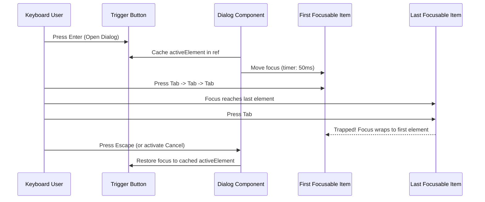

# Nano Route Focus Management & Trap Lifecycle Architecture

## 1. Focus Management Principles
In a desktop application, improper focus handling results in lost context, focus disappearance, or trapped keyboard users. Nano Route enforces four core focus invariants:
1. **Focus Visibility:** Every interactive element exhibits an obvious `:focus-visible` ring (2px solid purple `#8B5CF6` with 2px offset).
2. **Modal Trapping:** Dialogs, overlays, and confirmations trap `Tab` and `Shift+Tab` cycles strictly inside their boundaries.
3. **Focus Restoration:** Closing a dialog, dropdown, or drawer restores keyboard focus to the exact triggering element.
4. **Predictable Navigation Focus:** Changing application pages moves focus to the new page main heading (`<h1>`) or primary search input rather than leaving focus on a hidden element.

---

## 2. Modal Focus Trap Lifecycle

---

## 3. Asynchronous Operation Focus Rules
When an async operation executes (e.g. Save Settings, Verify Update, Restore Backup):
- The submit button remains focused during execution.
- If the button becomes temporarily disabled, the focus is retained on the parent form container with `tabindex="-1"`.
- Upon operation completion, focus returns to the primary action button or the newly created item.
- Focus **never** jumps unpredictably to the top of the body element.

---

## 4. Custom Component Focus Contracts

| Component | Initial Focus Target | Escape Key Behavior | Focus Restoration Target |
|:---|:---|:---|:---|
| **Dialog / Modal** | First interactive element (or Cancel button if destructive) | Closes modal | Opening trigger element |
| **DropdownMenu** | First menu item | Closes dropdown | Menu toggle button |
| **ConfirmDialog** | Safe "Cancel" button (prevents accidental deletion) | Closes dialog | Delete trigger button |
| **SearchField** | Input element | Clears query text (if non-empty) or blurs | Retained on input |
| **Toast Notification**| Does not steal focus; announced via `role="status"` | Dismissible via click/timer | N/A (Non-modal) |

