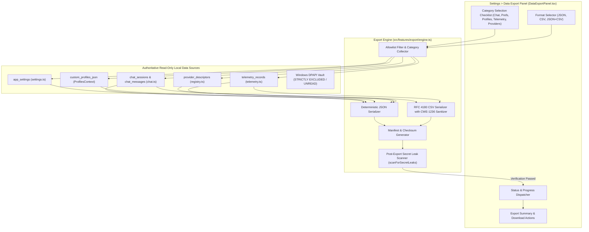

# Nano Route — User Data Export & Privacy Portability Architecture

**Document Reference:** `docs/export/NANO_ROUTE_DATA_EXPORT_ARCHITECTURE.md`  
**Application:** Nano Route Desktop (Windows 10/11 x64, Tauri v2)  
**Implementation Phase:** Step 70  
**Authoritative Architectural Specification**  

---

## 1. Executive Summary & Design Axioms

Step 70 establishes a controlled, local-first **User Data Export and Privacy Portability system** in Nano Route. The objective is to provide users complete transparency, ownership, and portable extraction capabilities over their locally stored data in standard, readable formats (JSON and RFC 4180 CSV) without conflating export with backup, disaster recovery, diagnostic reporting, or factory resets.

### Core Architectural Invariants

1. **Export is Disclosure, Not Deletion:** Exporting is strictly an observational, read-only process. It never deletes, modifies, rewrites, or marks source records in SQLite.
2. **Explicit Export Allowlist:** Only explicitly enumerated categories and properties are exportable. "Export All" means all allowlisted categories, never an unvetted disk dump or binary database file copy.
3. **Strict Credential & Secret Exclusion:** Windows DPAPI-encrypted API keys, plaintext secrets, and bearer tokens are strictly barred. Export packages undergo an automated post-export leak scan prior to delivery.
4. **CSV Injection Defense:** All tabular CSV output enforces defensive sanitization against spreadsheet formula execution (CWE-1236) by prefixing risky leading trigger characters (`=`, `+`, `-`, `@`, `\t`, `\r`) with single quotes.
5. **Decoupled System Boundaries:**
   - **Step 70 Export:** User-facing portability, inspection, and human/machine readability.
   - **Step 53 Backup:** Cryptographically verified point-in-time disaster recovery snapshots.
   - **Step 62 Diagnostics:** Redacted technical evidence for troubleshooting.
   - **Step 67 Profiles:** Workspace preference layout presets.
   - **Step 69 Reset:** Guarded baseline restorations and data wipes.

---

## 2. Architecture & Data Flow

---

## 3. Subsystem Roles & Responsibilities

- **`types.ts`:**
  - Declares canonical contracts: `ExportCategory`, `DataClassification`, `ExportFormat`, `ExportManifest`, and `ExportPackage`.
  - Enforces schema version `1` and format identifier `nano-route-export-package-v1`.
- **`catalog.ts`:**
  - Maintains descriptors for all 5 exportable categories.
  - Documents universal local data entity classification map and forbidden secret key patterns.
- **`csvSanitizer.ts`:**
  - Enforces RFC 4180 quoting and escaping rules.
  - Implements formula injection mitigation for untrusted user inputs.
- **`engine.ts`:**
  - Gathers requested categories via typed IPC read APIs.
  - Constructs `ExportManifest` with exact record counts and integrity checksums.
  - Executes post-export security validation scanning for leaked keys before releasing the payload.
- **`DataExportPanel.tsx`:**
  - Accessible settings UI providing category toggles, sensitivity badges, format selection, progress indicators, and instant downloads.

