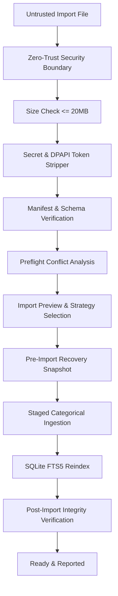

# Nano Route Data Import & Migration Architecture (Step 71)

## 1. Architectural Overview & Core Mission

Nano Route implements a local-first, zero-leakage, non-destructive **User Data Import & Migration Assistant**. It provides users with seamless configuration and conversation portability across machines and installations by consuming structured export packages (`nano-route-export-package-v1`) generated by Step 70.

## 2. Inviolable Architectural Invariants

1. **Untrusted Input Boundary**: All incoming files are treated as untrusted user input. Raw arbitrary SQL, unknown SQLite databases, or unchecked file pointers are barred at the boundary.
2. **Permanent Credential Rejection**: API keys, master passwords, bearer tokens, or DPAPI ciphertexts are strictly rejected and stripped recursively prior to deserialization or database persistence.
3. **Non-Destructive Execution**: The original import file on disk is never modified, relocated, or deleted.
4. **Collision Preservation**: Existing conversations are protected against silent overwrites. Users configure explicit collision policies (`SKIP_DUPLICATES`, `IMPORT_AS_NEW`, `KEEP_EXISTING`).
5. **Offline Capability**: Ingesting historical records operates completely offline without dispatching validation requests to third-party AI providers.

