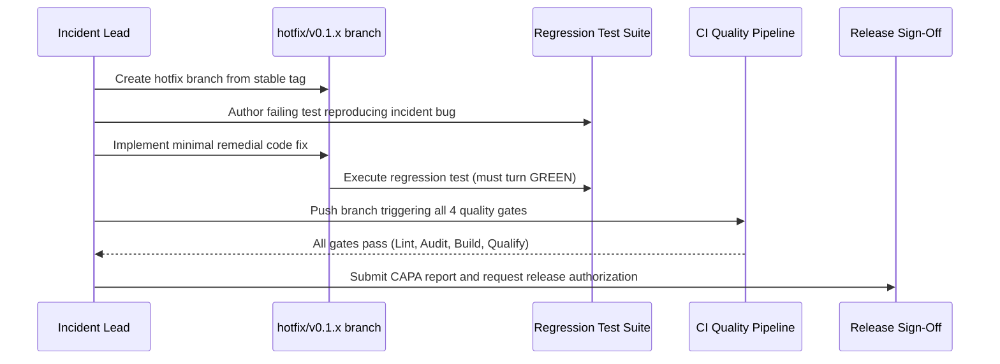

# Nano Route Corrective & Preventative Actions (CAPA) Engineering Guide

## 1. Principles of Corrective Engineering
A production incident is not resolved merely by patching the immediate defect. Every incident must yield:
1. **Direct Remediation:** A targeted, minimal code fix that addresses the root cause without introducing regressions.
2. **Automated Regression Test:** An automated test added to the regression test suite that reproduces the exact failure conditions and confirms the fix.
3. **Defensive Boundary Strengthening:** Input validation, timeout boundaries, fallback handlers, or schema sanitization to prevent similar failure classes.
4. **CI Gate Integration:** Ensuring the regression test runs as a blocking check in the Level 1 Fast Validation or Level 4 Qualification gates.

---

## 2. Corrective Action Tracking Register

| CAPA ID | Originating Incident | Domain | Corrective Action Description | Target Gate | Resolution State |
|:---|:---|:---|:---|:---|:---|
| **CAPA-58-01** | INC-CAT-D (Provider Drift) | IPC / Frontier | Implement defensive normalizer for multi-part OpenAI/Gemini responses | Level 1 Fast Validation | VERIFIED |
| **CAPA-58-02** | INC-CAT-G (DB Lockout) | Rust / SQLite | Add busy-timeout backoff and SQLite WAL checkpoint validation | Level 3 Production Build | VERIFIED |
| **CAPA-58-03** | INC-CAT-H (Signature Mismatch)| Tauri / Updater | Implement atomic staged update verification before file swap | Level 4 Qualification Gate | VERIFIED |
| **CAPA-58-04** | INC-CAT-K (DPAPI CryptProtect) | Rust / Windows | Add fallback user notification dialog on DPAPI context change | Level 1 Fast Validation | VERIFIED |
| **CAPA-58-05** | INC-CAT-L (Markdown Stream Lag)| React / UI | Decouple Markdown parsing to non-blocking tokenizer chunking | Level 1 Fast Validation | VERIFIED |

---

## 3. Engineering Workflow for Hotfix Implementation

---

## 4. Verification & Validation Rules
- **No Scope Creep:** Hotfix branches must contain only the remedial fix, the regression test, and essential documentation. Unrelated refactoring is strictly forbidden.
- **Backwards Compatibility:** Hotfixes must not alter SQLite schema versions or invalidate existing user configurations.
- **Audit Sign-off:** The Security Engineer must verify that no sensitive credentials or new untrusted dependencies were added.

