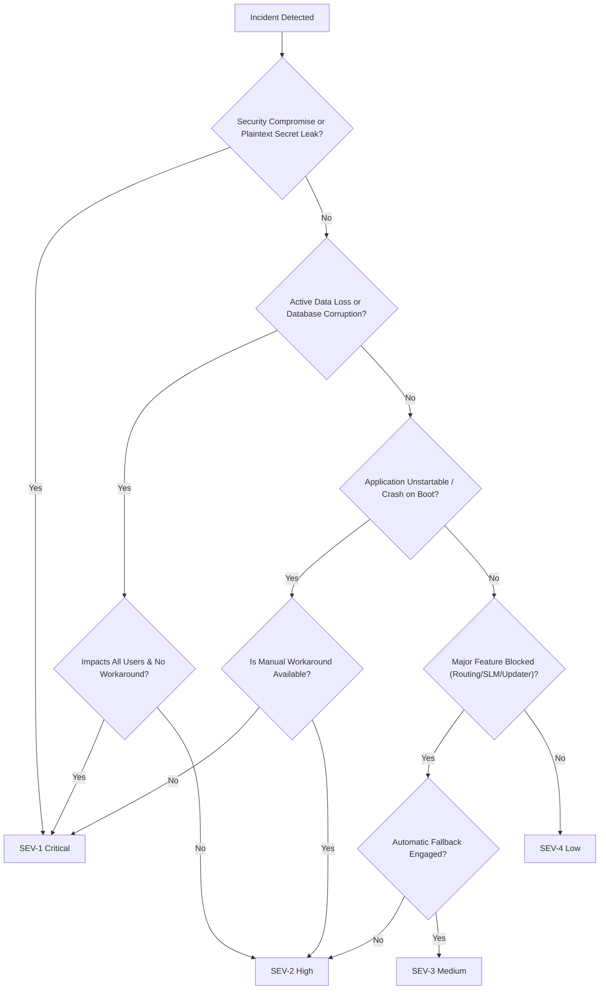

# Nano Route Incident Severity Model & SLA Matrix

## 1. Overview
This specification provides the authoritative severity scoring framework for incidents affecting Nano Route. Severity governs engineering response urgency, containment timelines, communication SLAs, and release governance.

---

## 2. Severity Classification Matrix

| Severity Level | Definition | Impact Scope | Data Loss Risk | Workaround Available | Response SLA | Resolution Target |
|:---|:---|:---|:---|:---|:---|:---|
| **SEV-1 (Critical)** | Catastrophic failure: total application unavailability, remote code execution risk, uncontained credential leakage, or persistent database corruption affecting all users. | System-wide / All users | Yes, active risk | No | < 1 hour | < 12 hours |
| **SEV-2 (High)** | Major feature impairment: primary routing engine offline, updater signature failure, or local SLM execution freeze without graceful degradation. | Widespread | Contained / Read-only | Workaround requires manual action | < 4 hours | < 48 hours |
| **SEV-3 (Medium)** | Degraded functionality: single frontier provider API drift, non-fatal IPC error, telemetry aggregation anomaly, or cosmetic Markdown parser lag. | Localized / Partial | None | Automatic fallback operational (e.g. SLM) | < 24 hours | Next minor/patch release (≤ 7 days) |
| **SEV-4 (Low)** | Minor cosmetic defect: UI styling inconsistency, edge-case hotkey failure, minor typo in documentation or settings dialog. | Isolated | None | Complete (feature usable) | < 72 hours | Next standard release cycle |

---

## 3. Severity Determination Flowchart

---

## 4. Operational Escalation Rules

### SEV-1 Escalation Path
1. **Immediate Lead Mobilization:** Senior Security Engineer, Senior Rust/Tauri Engineer, and Senior Release Engineer mobilized immediately.
2. **Branch Freeze:** Feature freeze on `main` until hotfix verification passes.
3. **Out-of-Band Release:** Authorized hotfix release deployment (`v0.1.x+hotfix`) with emergency changelog.

### SEV-2 Escalation Path
1. **Assignment:** Assigned to relevant domain engineer within 4 hours.
2. **Mitigation:** Deploy temporary mitigation (e.g. disable broken provider route via fallback configuration).
3. **Targeted Hotfix:** Ship targeted patch within 48 hours.

### SEV-3 / SEV-4 Lifecycle
- Tracked in maintenance backlog.
- Verified in continuous integration before batch inclusion in scheduled maintenance releases.

