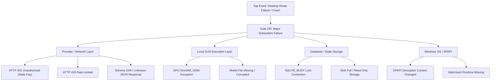

# Nano Route Root-Cause Analysis (RCA) Guide

## 1. Purpose & Analytical Framework
This guide provides engineers with systematic methodologies for isolating, diagnosing, and proving the root cause of production incidents in Nano Route without relying on cloud telemetry or violating user privacy.

The two mandated analytical frameworks are:
1. **Fault Tree Analysis (FTA):** Top-down deductive failure decomposition.
2. **5-Whys Iterative Questioning:** Sequential causal chain determination.

---

## 2. Fault Tree Analysis (FTA) for Desktop Incident Domains

---

## 3. Five-Whys Investigation Procedure

When conducting an RCA:
- Avoid blaming human error; focus on systemic flaws, missing defensive bounds, or incomplete test fixtures.
- Each "Why" must be substantiated by concrete evidence (sanitized logs, reproducible test case, or memory profile).
- The final "Why" must reach a systemic, architectural, or testing deficiency that can be prevented programmatically.

### Example RCA Walkthrough: Provider JSON Response Drift
1. **Why did the chat UI display a blank error?**
   - The IPC call rejected with an unhandled deserialization error.
2. **Why did deserialization fail?**
   - The provider returned a novel nested object format for `choices[0].message.content` (array of multimodal parts instead of string).
3. **Why did the client parser not handle the nested object?**
   - The parser expected a primitive `string` type without defensive schema normalization.
4. **Why was this schema assumption made?**
   - The contract tests only mocked legacy v1 chat completion payloads.
5. **Why were contract tests out of date?**
   - CI lacked an automated contract schema drift verification gate against updated upstream documentation.
   *Corrective Action:* Implement defensive content normalization and add upstream schema fixture tests.

---

## 4. Crash Diagnostic Isolation Protocols

### Rust Native Panic Isolation
1. Examine crash marker state written in AppData.
2. Inspect `panic_hook` output in sanitized crash logs.
3. Validate memory allocations and ensure bounds checks on unsafe blocks.

### Frontend Uncaught Exception Isolation
1. Trace component stack from React `ErrorBoundary`.
2. Inspect sanitized IPC response payloads for unexpected null/undefined fields.
3. Replicate in Vitest / Node test runner with simulated faulty payload.

