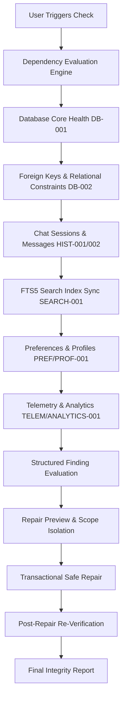

# Nano Route Data Integrity & Reconciliation Architecture (Step 72)

## 1. Architectural Mission & Philosophy

Nano Route Step 72 provides a local-first, read-only-by-default **Post-Import Reconciliation & Data Integrity Verification** subsystem. Its primary purpose is to ensure that following Step 71 data imports, migrations, or ordinary system operations, all relational records, search indexes, preference values, and analytics metrics adhere strictly to documented invariants.

## 2. Inviolable Guarantees

1. **Verification First, Repair Second**: Inspection never modifies SQLite or local storage state.
2. **Read-Only Default**: Running checks leaves the database completely untouched.
3. **No Arbitrary SQL / Repair Payloads**: All checks and repairs use registered, typed descriptors.
4. **Targeted Safe Repairs**: Only approved repairs (`REBUILD_SEARCH_INDEX`, `REMOVE_ORPHANED_MESSAGES`, `RESET_INVALID_PREFERENCES`, `PRUNE_CORRUPT_PROFILES`, `REPAIR_INVALID_SESSION_ROUTE`) may be invoked.
5. **Post-Repair Verification**: Every repair execution automatically re-runs the associated check to guarantee resolution.

