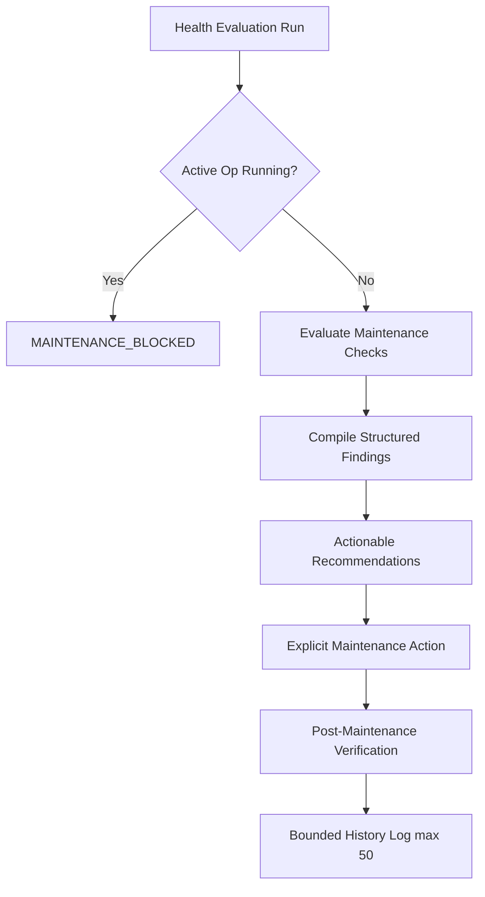

# Nano Route Data Health Monitoring & Maintenance Architecture (Step 73)

## 1. Architectural Mission & Principles

Nano Route Step 73 implements a local-first, low-overhead **Data Health Monitoring & Preventive Maintenance** subsystem. Its purpose is to detect gradual storage overhead, stale temporary staging artifacts, and index drift before they require disaster recovery or emergency repair.

## 2. Distinction of Core Operational Concepts

- **Health Monitoring**: Observational detection of storage overhead and thresholds (zero mutations).
- **Maintenance**: Safe, bounded, proactive housekeeping (e.g. cleaning abandoned temporary files >24h old).
- **Repair**: Targeted restoration of broken invariants via Step 72 catalog.
- **Recovery**: Structural database rollback or restoration via Step 53 Disaster Recovery.

## 3. Inviolable Guarantees

1. **No Silent Self-Healing**: Never silently deletes conversations, resets preferences, or modifies credentials.
2. **Operation Locking**: Safely blocked during active prompt streaming, database writes, backups, or updates.
3. **Bounded Footprint**: Maintenance history buffer is capped at 50 records; zero telemetry upload or cloud monitoring.

