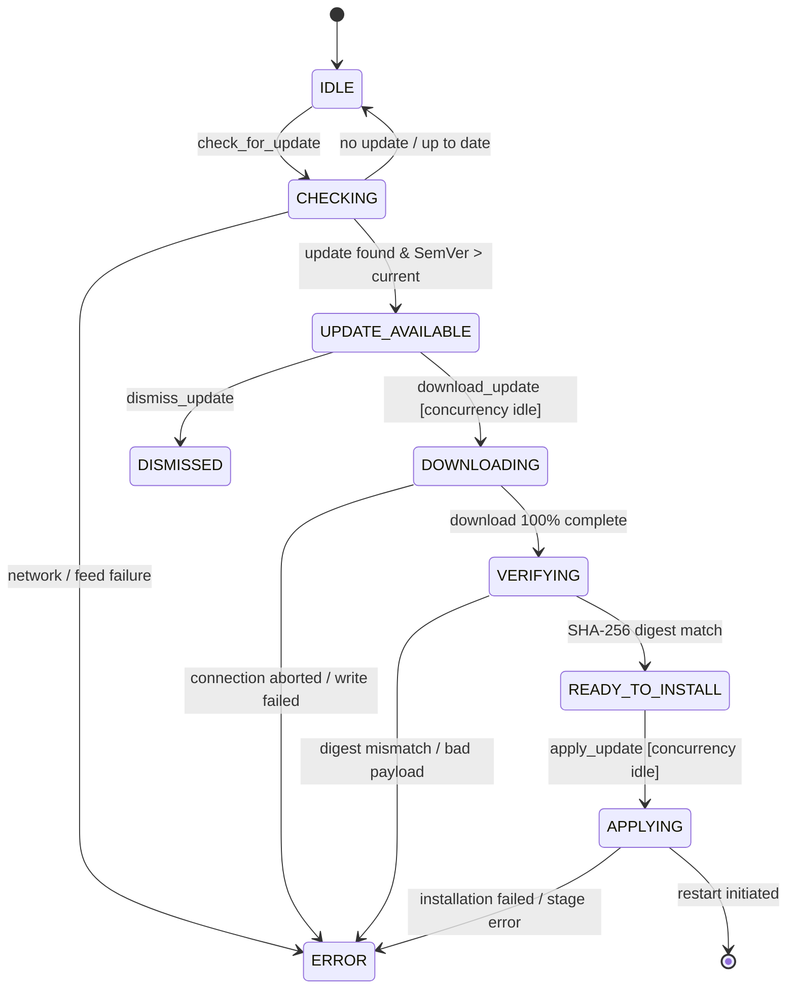

# Nano Route Update State Machine Specification (Step 52)

## 1. State Machine Definitions

The update lifecycle transitions through deterministic states:

## 2. Invariants & Guard Conditions

1. **Guard `CONCURRENCY_IDLE`**: Transitions to `DOWNLOADING` or `APPLYING` are blocked if `activePromptStreaming === true` or `activeDatabaseWrite === true`.
2. **Guard `SEMVER_FORWARD`**: Transition to `UPDATE_AVAILABLE` requires candidate version to strictly exceed current installed version according to SemVer rules (unless channel is switched).
3. **Guard `INTEGRITY_VERIFIED`**: Transition to `READY_TO_INSTALL` requires byte-for-byte matching of computed SHA-256 hash against metadata payload hash.
4. **Guard `BACKUP_CONFIRMED`**: If `requiresDatabaseMigration === true`, application staging requires generation and verification of a `RollbackPlanDto` containing a valid pre-update database backup path.

