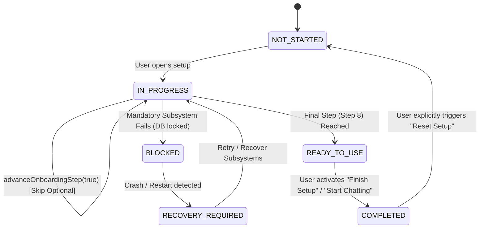

# Nano Route First-Run State Machine Specification

## 1. Overview
The onboarding subsystem is governed by a pure, deterministic finite state machine implemented in `src/features/onboarding/stateMachine.ts`. Transitions are driven by explicit user actions (`NEXT`, `BACK`, `SKIP`, `FINISH`) or system readiness evaluations.

---

## 2. State & Substate Taxonomy

### 2.1 Primary States
- **`NOT_STARTED`:** Fresh installation; initial launch before user engagement.
- **`IN_PROGRESS`:** User has actively engaged with setup (steps 1 through 7).
- **`READY_TO_USE`:** All mandatory readiness prerequisites met; user reached final screen.
- **`COMPLETED`:** User completed setup and transitioned into the main application.
- **`SKIPPED`:** User skipped optional steps (e.g. cloud provider configuration).
- **`BLOCKED`:** Mandatory subsystem offline (e.g. SQLite database unavailable).
- **`RECOVERY_REQUIRED`:** Previous setup was interrupted by a crash or fatal process termination.

### 2.2 Functional Substates
- **`DATABASE_READY`:** SQLite database open, WAL mode active, migrations current.
- **`SLM_READY`:** Local SLM runtime initialized and model loaded for prompt evaluation.
- **`PROVIDER_REGISTRY_READY`:** Frontier model provider registry initialized with at least 1 provider.
- **`PROVIDER_CREDENTIALS_READY`:** At least one frontier API key encrypted in DPAPI vault.
- **`MODEL_SELECTION_READY`:** Authoritative model catalog loaded with capabilities.
- **`ROUTING_READY`:** Router has sufficient candidates (either local SLM or cloud provider) to evaluate prompts.

---

## 3. State Transition Diagram



---

## 4. State Persistence Schema

The onboarding record is persisted under `localStorage.getItem("nr_onboarding_progress_v1")`:

```json
{
  "version": 1,
  "state": "COMPLETED",
  "currentStepId": "complete",
  "completedStepIds": ["welcome", "system_readiness", "local_slm", "test_readiness"],
  "skippedStepIds": ["provider_setup", "model_readiness", "routing_readiness"],
  "activeSubstates": [
    "DATABASE_READY",
    "SLM_READY",
    "PROVIDER_REGISTRY_READY",
    "MODEL_SELECTION_READY",
    "ROUTING_READY"
  ],
  "startedAt": "2026-11-13T19:00:00.000Z",
  "updatedAt": "2026-11-13T19:05:00.000Z",
  "completedAt": "2026-11-13T19:05:30.000Z"
}
```

- **Invariant:** If parsing fails or the version is incompatible, the engine falls back to `createInitialOnboardingProgress()`.

