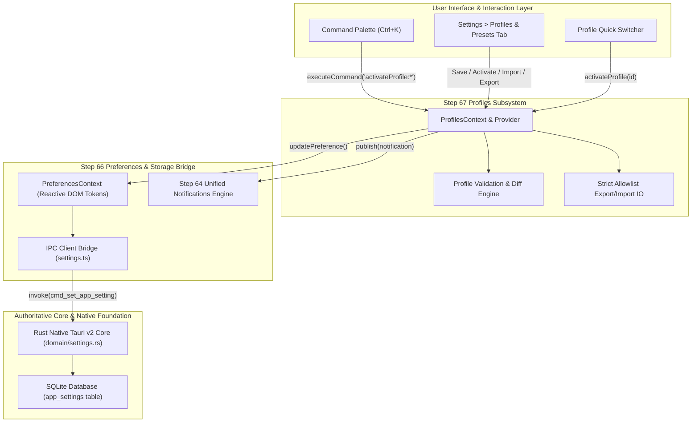
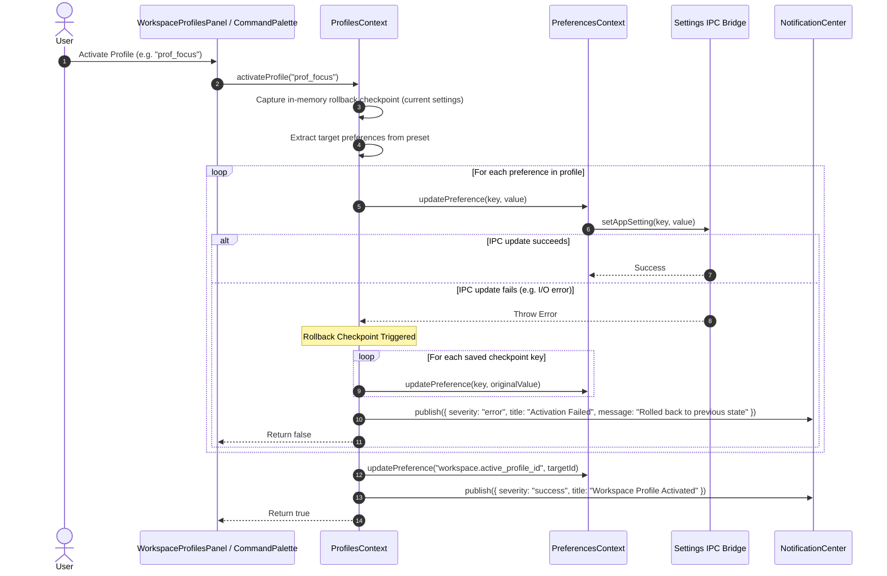

# Nano Route — Workspace Profile Architecture & Interaction Model

**Document Reference:** `docs/profiles/NANO_ROUTE_WORKSPACE_PROFILE_ARCHITECTURE.md`  
**Application:** Nano Route Desktop (Windows 10/11 x64, Tauri v2)  
**Implementation Phase:** Step 67  
**Authoritative Status:** Production Design Specification  

---

## 1. Executive Summary & Design Philosophy

Nano Route Step 67 establishes a local, explicit, deterministic, and bounded **Workspace Profile and Preference Preset system**. The system empowers desktop users to seamlessly switch between specialized ergonomic contexts (such as distraction-free writing, high-density analytics, accessible high-contrast navigation, or custom configurations) without altering underlying application security invariants, provider credentials, routing policy models, conversation histories, or local database state.

### Core Architectural Axioms

1. **Strict Presentation & Interaction Scope:** Profiles are exclusively snapshots of non-sensitive user presentation and interaction preferences. Profiles are **never** user accounts, cloud identities, sync containers, or licensing entities.
2. **Zero Credentials & Zero Data Leakage:** A workspace profile or export file strictly excludes and filters out API keys, DPAPI ciphertexts, passwords, tokens, private prompts, conversation transcripts, and raw database paths.
3. **Immutability of Authoritative Subsystems:** Activating or switching a profile has **zero impact** on routing decision algorithms, candidate scoring weights, provider credential readiness, SLM on-device inference runtimes, or disaster recovery backups.
4. **Atomic Activation with Rollback Guarantee:** Switching profiles is an atomic transactional operation. Prior to applying target preferences, the active configuration is checkpointed in memory. If any key update fails or rejects, the system immediately rolls back to the prior configuration, emits a unified notification alert, and leaves the application in a deterministic, functional state.
5. **Safe Built-in Baselines:** Nano Route bundles 4 canonical, immutable built-in presets (`prof_default`, `prof_focus`, `prof_compact`, and `prof_accessibility`) that cannot be deleted or corrupted, guaranteeing an always-available recovery baseline.

---

## 2. Architecture & Subsystem Layering

### Subsystem Roles & Responsibilities

- **`ProfilesContext` (`src/features/profiles/ProfilesContext.tsx`):** Coordinates profile state, merges canonical built-in presets with persisted custom profiles from SQLite (`workspace.profiles`), executes atomic activation, tracks `workspace.active_profile_id`, and delivers user feedback via `useNotifications()`.
- **`engine.ts` (`src/features/profiles/engine.ts`):** Pure TypeScript logic for:
  - Validating incoming profile objects against the canonical preference catalog.
  - Computing diffs between current settings and target presets.
  - Sanitizing user-provided names (max 40 chars) and descriptions (max 120 chars).
  - Filtering untrusted imports against `EXPORTABLE_PREFERENCE_KEYS`.
- **`presets.ts` (`src/features/profiles/presets.ts`):** Canonical definitions of the four immutable presets (`prof_default`, `prof_focus`, `prof_compact`, and `prof_accessibility`).
- **`WorkspaceProfilesPanel.tsx` (`src/features/profiles/components/WorkspaceProfilesPanel.tsx`):** Settings workspace tab rendering active profile banner, standard preset grid, custom profile management, save modal, and untrusted import diff preview modal.

---

## 3. Canonical Built-in Presets

| Profile ID | Display Name | Intended Workflow | Key Preference Configuration |
| :--- | :--- | :--- | :--- |
| `prof_default` | **Default Workspace** | Balanced day-to-day desktop usage | Dark theme, comfortable density, system motion, 100% scale, full toast communications, overview startup route. |
| `prof_focus` | **Focus & Deep Work** | Distraction-free writing and coding | Dark theme, comfortable density, suppressed non-critical toasts, collapsed sidebar, boots straight to Chat studio. |
| `prof_compact` | **Compact High-Density** | Data inspection, side-by-side splits | Dark theme, compact density, compressed message turn spacing, visible timestamps, collapsed sidebar. |
| `prof_accessibility`| **High-Visibility Accessibility**| Low-vision, contrast, motor assistance | Light canvas (15.4:1 contrast ratio), 110% text scaling, 3px high-contrast focus rings, reduced motion, 8000ms toast timeouts. |

---

## 4. Atomic Activation & Rollback Interaction Flow

---

## 5. Storage Model & Concurrency Bounds

1. **Persistence Mechanism:** Custom profiles are serialized as a UTF-8 JSON array string and stored in SQLite's `app_settings` key-value table under key `workspace.profiles`. The active profile ID is stored under `workspace.active_profile_id`.
2. **Cardinality Ceiling:** A strict ceiling of **10 total profiles** is enforced (`MAX_PROFILES_COUNT = 10`), leaving room for up to 6 custom profiles alongside the 4 standard built-in presets.
3. **Payload Boundaries:**
   - Profile Name: 2 to 40 characters (`MAX_PROFILE_NAME_LENGTH = 40`).
   - Profile Description: 0 to 120 characters (`MAX_PROFILE_DESC_LENGTH = 120`).
   - JSON File Size: 16,384 bytes (`MAX_PROFILE_PAYLOAD_BYTES = 16KB`).
4. **Fallback Safety Invariant:** If a user deletes an active custom profile, the system deterministically reverts `workspace.active_profile_id` to `"prof_default"`, ensuring the application is never left pointing to an orphaned or nonexistent profile.

