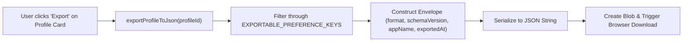
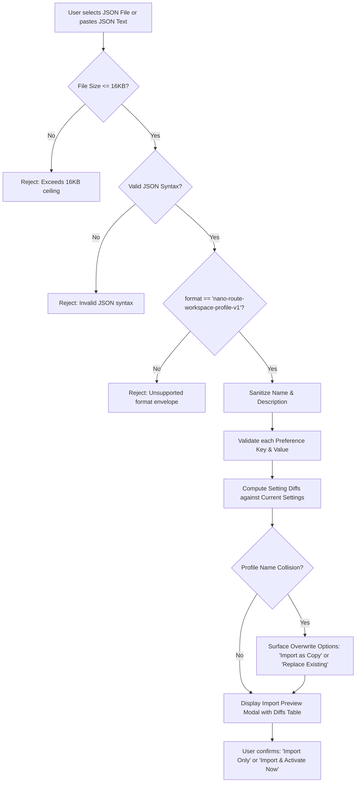

# Nano Route — Workspace Profile Import & Export Guide

**Document Reference:** `docs/profiles/NANO_ROUTE_WORKSPACE_PROFILE_IMPORT_EXPORT.md`  
**Application:** Nano Route Desktop (Windows 10/11 x64, Tauri v2)  
**Implementation Phase:** Step 67  
**User Guide & Workflow Reference**  

---

## 1. Profile Export Workflow

The Export workflow enables users to serialize any built-in preset or custom workspace profile into a portable, standardized `.json` file for backup, team distribution, or multi-device configuration.

### Export Characteristics

- **Format:** Formatted JSON conforming to schema `nano-route-workspace-profile-v1`.
- **File Naming Convention:** `nano-route-profile-<sanitized-profile-name>.json` (e.g. `nano-route-profile-focus-deep-work.json`).
- **MIME Type:** `application/json`.
- **Payload Guarantee:** 100% free of credentials, tokens, network endpoints, or private chat conversations.

---

## 2. Profile Import & Safe Diff Preview Workflow

When importing a profile from disk or clipboard, Nano Route treats the file as untrusted external input and executes a multi-stage validation and preview sequence before applying changes.

---

## 3. The Import Preview & Diffs Modal

The Import Preview modal provides total visibility and control over pending modifications:

1. **Profile Identity:** Displays the candidate profile name, description, and schema version.
2. **Collision Warning:** If a custom profile with the same name already exists, the user is alerted and presented with two choices:
   - **Import as Copy:** Creates a new profile with `(Copy)` appended to the name and a fresh unique ID.
   - **Replace Existing:** Updates the existing profile with the new preferences and metadata.
3. **Interactive Diffs Table:** Lists each preference with its human-readable label, current active value, target imported value, and visual highlight if the value will change (`willChange = true`).
4. **Execution Buttons:**
   - **Cancel:** Aborts import with zero state modifications.
   - **Import Only:** Saves the profile into the registry for later use without altering active workspace settings.
   - **Import & Activate Now:** Saves the profile and immediately executes atomic activation.

