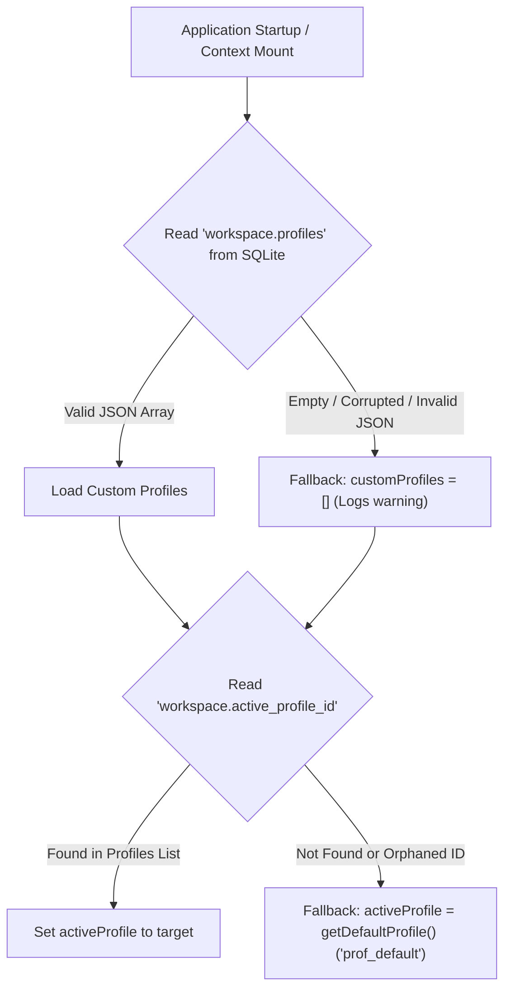

# Nano Route — Workspace Profile Migration, Compatibility & Versioning

**Document Reference:** `docs/profiles/NANO_ROUTE_WORKSPACE_PROFILE_MIGRATION.md`  
**Application:** Nano Route Desktop (Windows 10/11 x64, Tauri v2)  
**Implementation Phase:** Step 67  
**System Architecture & Migration Specification**  

---

## 1. Migration from Step 66 to Step 67

Nano Route Step 66 introduced the authoritative `app_settings` key-value store for individual user preferences (`appearance.theme_mode`, `chat.show_timestamps`, etc.). Step 67 introduces local profiles without altering the underlying Step 66 setting keys or requiring database migrations.

### SQLite Storage Strategy

| Setting Key | Type | Default Value | Role in Step 67 |
| :--- | :--- | :--- | :--- |
| `workspace.active_profile_id` | string | `"prof_default"` | Tracks which workspace preset or custom profile is currently active. |
| `workspace.profiles` | string (JSON array) | `"[]"` | Persists the array of custom user-created profiles. |

### Upgrade Flow

1. On initial launch under Step 67, `workspace.active_profile_id` defaults to `"prof_default"`.
2. Existing Step 66 settings remain fully intact and active in the database.
3. If the user saves the current workspace configuration as a profile, the active preference snapshot is serialized into `workspace.profiles`.
4. If a user deletes an active custom profile, the system deterministically falls back to `"prof_default"`.

---

## 2. Schema Versioning & Backward Compatibility

### Version 1 (`nano-route-workspace-profile-v1`)

- Schema version is integer `1`.
- Payloads declare `"format": "nano-route-workspace-profile-v1"`.
- If an imported file contains `schemaVersion > 1`, Nano Route rejects the file with a clear diagnostic message:
  `"Unsupported profile schema version X. Current supported version is 1."`
- If an imported file contains legacy or unversioned keys, unknown keys are filtered out while valid known keys are retained.

---

## 3. Corruption Recovery & Safe Fallback Matrix

| Scenario | Symptom | Self-Healing Behavior |
| :--- | :--- | :--- |
| **Corrupted `workspace.profiles` in SQLite** | Malformed JSON string in database. | `ProfilesContext` safely catches JSON parse errors and returns `[]`. Built-in presets remain 100% accessible. |
| **Orphaned `workspace.active_profile_id`** | Active profile ID references deleted or missing profile. | `activeProfile` resolver falls back to `getDefaultProfile()` (`"prof_default"`). |
| **Partial Atomic Activation Failure** | Storage write error during profile activation. | Rollback checkpoint restores original preference snapshot. Zero partial state is left behind. |
| **Built-in Deletion Attempt** | User attempts to delete a standard preset via API or script. | Subsystem rejects operation with `Error("Built-in presets cannot be deleted.")`. |

