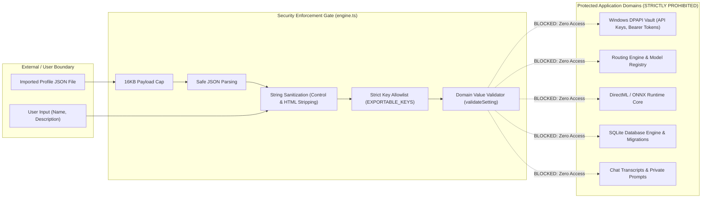

# Nano Route — Workspace Profile Security, Threat Modeling & Data Protection

**Document Reference:** `docs/profiles/NANO_ROUTE_WORKSPACE_PROFILE_SECURITY.md`  
**Application:** Nano Route Desktop (Windows 10/11 x64, Tauri v2)  
**Implementation Phase:** Step 67  
**Security Classification:** Strict Non-Sensitive Boundary  

---

## 1. Security Architecture & Threat Boundary

The Workspace Profile subsystem in Nano Route is intentionally architected as a **purely non-sensitive presentation configuration layer**. It operates under strict security invariants designed to prevent privilege escalation, data exfiltration, arbitrary code execution, and configuration tampering.

### Threat Boundary Summary

---

## 2. Threat Modeling & Mitigation Analysis

| Threat ID | Threat Vector | Potential Impact | Nano Route Defensive Mitigation |
| :--- | :--- | :--- | :--- |
| **TH-01** | **Secret Exfiltration in Export** | Leaking DPAPI-protected provider API keys, authorization tokens, or user passwords when sharing a profile file. | **Strict Output Filtering:** `exportProfileToJson()` iterates exclusively through `EXPORTABLE_PREFERENCE_KEYS`. Credential keys (`openai.api_key`, `anthropic.auth_token`, etc.) are never queried, serialized, or emitted. |
| **TH-02** | **Credential Injection via Import** | Attacker crafts a profile file attempting to overwrite provider keys or endpoints with rogue attacker-controlled endpoints. | **Allowlist Enforcement:** `parseAndValidateImport()` discards and rejects any key outside `EXPORTABLE_PREFERENCE_KEYS`. Injected keys are classified as unsupported and eliminated before constructing the profile. |
| **TH-03** | **Denial of Service (JSON Bomb / OOM)** | Attacker feeds a multi-gigabyte or deeply nested JSON file to freeze or crash the desktop process. | **Payload Size Cap:** Import functions verify `jsonString.length <= 16,384` bytes (16KB) prior to invoking `JSON.parse()`. Files exceeding 16KB are rejected immediately. |
| **TH-04** | **Prototype Pollution (`__proto__`, `constructor`)** | Attacker crafts payloads with `__proto__` properties to pollute JavaScript Object prototype. | **Safe Construction:** Profile preferences are extracted via explicit key iteration into fresh object literals. Prototype-polluting keys are ignored as they do not exist in the allowlist. |
| **TH-05** | **Stored XSS / UI Tag Injection** | Malicious profile names or descriptions containing `<script>` or HTML tags rendered in settings cards. | **Input Sanitization:** `sanitizeProfileName` and `sanitizeProfileDescription` strip control characters (`\x00-\x1F\x7F`) and angle brackets (`<`, `>`). React JSX renders string literals with automatic HTML entity escaping. |
| **TH-06** | **Arbitrary Code Execution** | Attempting to execute shell scripts or native commands through profile activation. | **Declarative Action Model:** Command palette actions for profile switching map exclusively to hardcoded `activateProfile(id)` calls. No shell commands or dynamic eval routines exist. |

---

## 3. Data Protection Invariants

1. **Zero Decrypted Secrets in Profiles:** Profile data structures and export files **never** contain decrypted secrets, DPAPI blobs, or plaintext passwords.
2. **Zero Conversation Leakage:** User chat history, prompt templates, messages, attachments, and session names are completely absent from profile data.
3. **Local Storage Parity:** Custom profiles reside in the local SQLite `app_settings` table on the user's workstation. No cloud synchronization, telemetry export, or telemetry tracking of profile contents occurs.
4. **Untrusted Input Treatment:** All profile files imported from disk or pasted into the UI are treated as untrusted external input and subjected to full syntax, schema, and domain validation.

