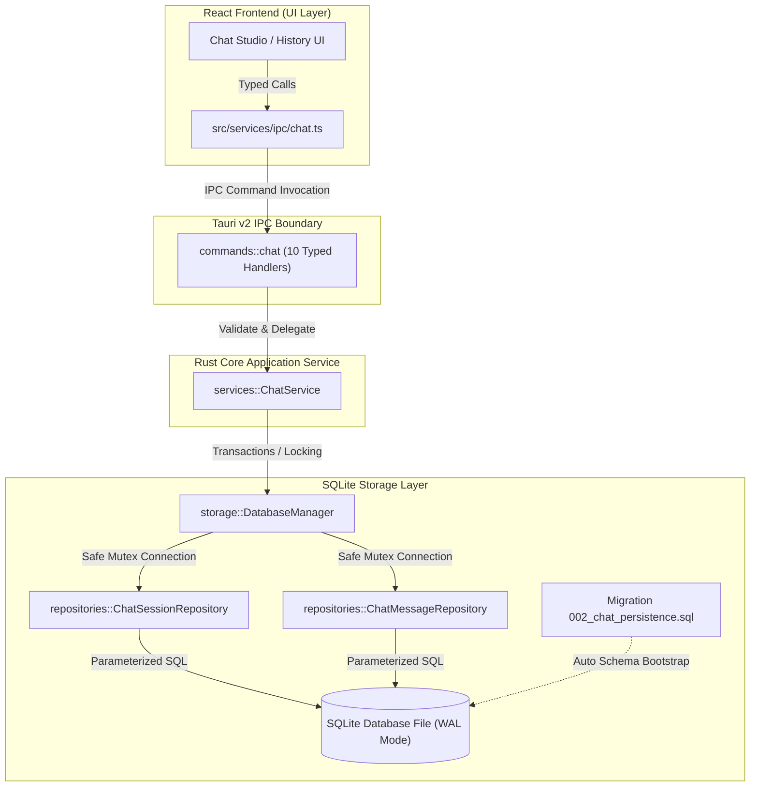
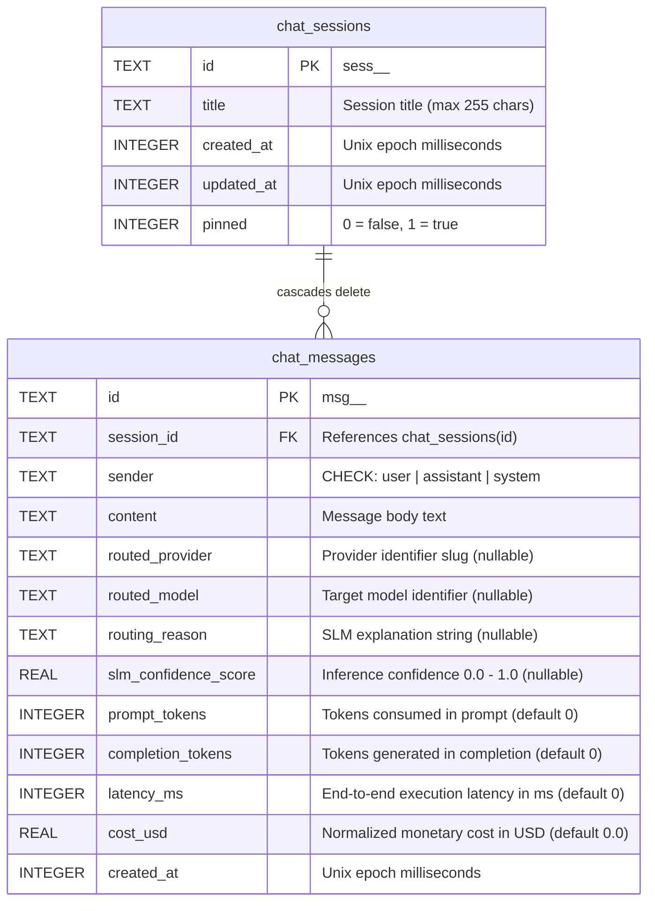

# Nano Route — Chat Persistence Subsystem Architecture (Step 17)
**Version:** 1.15.0  
**Phase:** Step 17 of 50 — Master Roadmap  
**Subsystem:** SQLite Application Persistence, Chat Sessions, Message Ledger & Routing Metadata  
**Author:** MoonVerse Studios Architecture Team  
**Verification Status:** 100% Validated (108 Tests Passing, 0 Regressions)

---

## 1. Executive Summary & Purpose
The **Chat Persistence Subsystem** establishes durable, ACID-compliant local storage for conversational sessions and structured messages within **Nano Route**. Built on top of the embedded SQLite infrastructure introduced in Step 16, this subsystem records user prompts, assistant completions, system instructions, and vital routing analytics—including SLM confidence scores, model descriptors, token telemetry, latency, and cost metadata.

---

## 2. Architectural Data Flow Diagram



---

## 3. Relational Schema Architecture



---

## 4. Migration Specification (`002_chat_persistence.sql`)
The schema migration is registered as version 2 in the embedded migration catalog:

```sql
-- Table: chat_sessions
CREATE TABLE IF NOT EXISTS chat_sessions (
    id TEXT PRIMARY KEY,
    title TEXT NOT NULL,
    created_at INTEGER NOT NULL,
    updated_at INTEGER NOT NULL,
    pinned INTEGER NOT NULL DEFAULT 0
);

-- Table: chat_messages
CREATE TABLE IF NOT EXISTS chat_messages (
    id TEXT PRIMARY KEY,
    session_id TEXT NOT NULL,
    sender TEXT NOT NULL CHECK(sender IN ('user', 'assistant', 'system')),
    content TEXT NOT NULL,
    routed_provider TEXT NULL,
    routed_model TEXT NULL,
    routing_reason TEXT NULL,
    slm_confidence_score REAL NULL,
    prompt_tokens INTEGER NOT NULL DEFAULT 0,
    completion_tokens INTEGER NOT NULL DEFAULT 0,
    latency_ms INTEGER NOT NULL DEFAULT 0,
    cost_usd REAL NOT NULL DEFAULT 0.0,
    created_at INTEGER NOT NULL,
    FOREIGN KEY(session_id) REFERENCES chat_sessions(id) ON DELETE CASCADE
);

-- Monotonic sequencing and rapid session list indexes
CREATE INDEX IF NOT EXISTS idx_chat_messages_session_created 
    ON chat_messages(session_id, created_at, id);

CREATE INDEX IF NOT EXISTS idx_chat_sessions_updated_at 
    ON chat_sessions(updated_at DESC);
```

---

## 5. Domain Entities (`src-tauri/src/domain/chat.rs`)
Pure, transport-independent entities:
- `MessageSender`: `User`, `Assistant`, `System` with strict serialization and validation.
- `ChatMessageMetadata`: captures `routed_provider`, `routed_model`, `routing_reason`, `slm_confidence_score`, `prompt_tokens`, `completion_tokens`, `latency_ms`, and `cost_usd`.
- `ChatSession`: identity, title, pinning status, and millisecond timestamps.
- `ChatMessage`: relational child entity linking turn content with metadata.
- `ChatConversation`: aggregate entity containing session metadata and its sequence of messages.

---

## 6. Repository Architecture
Isolated SQL execution boundaries located in `src-tauri/src/storage/repositories/`:
1. `ChatSessionRepository`:
   - `insert`: persists a new session.
   - `get_by_id`: retrieves a single session by primary key.
   - `list`: retrieves sessions ordered by `pinned DESC, updated_at DESC LIMIT ? OFFSET ?`.
   - `update_title`: updates title and touches timestamp.
   - `set_pinned`: modifies boolean pin flag.
   - `touch_updated_at`: updates session activity timestamp.
   - `delete`: removes session (triggering SQLite CASCADE).
   - `count`: counts total persisted sessions.
2. `ChatMessageRepository`:
   - `insert`: appends message record with 13 discrete columns.
   - `get_by_id`: fetches message by primary key.
   - `list_for_session`: deterministic ascending read using `ORDER BY created_at ASC, id ASC`.
   - `delete`: deletes individual message turn.
   - `count_for_session`: calculates total turn count for a given session.

---

## 7. Atomic Transaction & Service Layer (`ChatService`)
Located at `src-tauri/src/services/chat.rs`. Guarantees ACID guarantees across all state mutations:
- **Atomic Message Append:**
  Executing `append_message` runs an immediate SQLite transaction:
  1. Checks target session existence. If missing, aborts and returns `AppError::NotFound`.
  2. Inserts message into `chat_messages`.
  3. Updates parent session's `updated_at` column in `chat_sessions`.
  4. Commits transaction atomically.
- **Cascade Deletion Guarantee:**
  Because `PRAGMA foreign_keys = ON;` is enforced at connection creation (Step 16), deleting a session deletes all child messages immediately and atomically without dangling orphans.

---

## 8. Tauri IPC Command Surface (`src-tauri/src/commands/chat.rs`)
Exposes 10 thin, strongly-typed command handlers registered in `tauri::generate_handler![]`:
1. `cmd_create_chat_session`: creates session with optional custom title and pinned flag.
2. `cmd_get_chat_session`: retrieves session metadata.
3. `cmd_list_chat_sessions`: retrieves paginated list of sessions.
4. `cmd_rename_chat_session`: updates conversation title.
5. `cmd_set_chat_session_pinned`: toggles pinned state.
6. `cmd_delete_chat_session`: deletes conversation and all messages.
7. `cmd_append_chat_message`: appends user/assistant/system message with metadata.
8. `cmd_get_chat_messages`: retrieves ordered messages for a session.
9. `cmd_get_chat_conversation`: retrieves full thread in a single native invocation.
10. `cmd_delete_chat_message`: deletes a single message.

---

## 9. TypeScript IPC Client & Browser Fallback (`src/services/ipc/chat.ts`)
Provides zero-friction development and automated testing:
- Validates inputs before boundary crossing (sender enumeration, non-empty content, length boundaries).
- Implements complete in-memory mock store when running in standard browser development mode (`!isTauriContext()`).
- In simulated Tauri mode or production, routes requests via `safeInvoke`.

---

## 10. Verification & Test Suite Summary
- **Test File:** `src/services/ipc/__tests__/chat.test.ts`
- **Total Repository Test Count:** 108 passing tests across 54 suites.
- **Coverage Areas:**
  - Session lifecycle and pagination.
  - Assistant routing metadata persistence.
  - Monotonic sequencing tie-breaking (`created_at ASC, id ASC`).
  - Full conversation thread retrieval.
  - Cascade deletion verification.
  - Malformed sender and empty content rejection.
  - Mock Tauri IPC round-trip execution.

