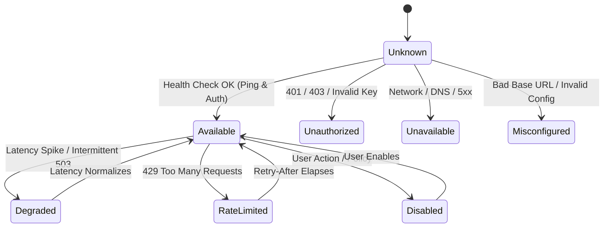

# Nano Route — AI Provider Abstraction Layer & Client Contract
**Document ID:** `NANO_ROUTE_PROVIDER_ARCHITECTURE`  
**Version:** `1.0.0` (Milestone 14 / Step 14 of 50)  
**Status:** `APPROVED & VALIDATED`  
**Classification:** Core System Architecture Specification  

---

## 1. Executive Summary & Purpose

Nano Route is designed from first principles as a local-first, vendor-neutral desktop AI orchestration system. The core premise of Nano Route is that the user's intent should dictate model selection rather than rigid vendor lock-in. 

To achieve this without degrading code maintainability, the application decouples provider implementations from the rest of the application using a single, unified Rust trait contract: `ProviderClient`.

This document specifies the authoritative contract, normalization pipelines, capability queries, error classification, health state machine, and cancellation mechanics for all AI provider integrations in Nano Route.

---

## 2. Architectural Invariants & Clean Separation

The provider abstraction layer adheres to four non-negotiable architectural boundaries:

1. **Zero UI Contamination:** Frontend screens (Chat Studio, Dashboard, Settings) interact solely with high-level IPC commands or domain abstractions. UI code never constructs raw provider HTTP headers, proprietary JSON envelopes, or vendor-specific payloads.
2. **Zero Routing Logic Contamination:** The `ProviderClient` trait executes requests; it does NOT decide *which* provider or model should run. Routing intelligence (SLM router, fallback policies, cost optimizers) lives in dedicated routing subsystems.
3. **Zero Credential Persistence in Requests:** Canonical `ProviderRequest`, `ProviderModel`, and `ProviderMetadata` structures NEVER carry raw API keys, bearer tokens, or password strings. Credentials reside exclusively in the Windows DPAPI encrypted vault and are injected at the adapter boundary.
4. **Dynamic Dispatch & Thread Safety:** Every provider adapter implements `#[async_trait] pub trait ProviderClient: Send + Sync` and is stored behind `Arc<dyn ProviderClient + Send + Sync>`, enabling dynamic runtime registration, unregistration, and hot-swapping.

---

## 3. Provider Identity & Well-Known Providers

Every AI provider adapter is identified by a strongly-typed `ProviderId` value object:
- **Slug Constraints:** Length between 2 and 64 characters; matches regex `^[a-z0-9][a-z0-9._-]*$`.
- **Pre-defined Constants:**
  - `openai`: OpenAI API (GPT-4o, o1, o3-mini)
  - `anthropic`: Anthropic Messages API (Claude 3.5 Sonnet, Haiku, Opus)
  - `gemini`: Google Gemini API (Gemini 2.5 Flash, Pro)
  - `deepseek`: DeepSeek API (DeepSeek-V3, R1)
  - `mistral`: Mistral AI API (Mistral Large, Codestral, Pixtral)
  - `xai`: xAI API (Grok 2, Grok 3)
  - `groq`: Groq LPU Ultra-Low Latency Inference
  - `local`: Local on-device SLMs (via ONNX / llama.cpp / GGUF engine)
  - `custom`: Generic OpenAI-compatible custom endpoints (vLLM, Ollama, LM Studio)

---

## 4. Provider Capability Matrix & Query API

Different providers and model families offer distinct feature sets. Nano Route avoids runtime failure through a discrete capability taxonomy:

```
ProviderCapability:
├── text_generation          (Basic raw completion)
├── chat_completion          (Multi-turn role-based dialog)
├── streaming                (Server-Sent Events / Chunked streaming)
├── system_prompts           (Dedicated system instruction support)
├── tool_calling             (JSON function calling / schemas)
├── json_mode                (Constrained JSON object generation)
├── vision_input             (Multimodal image understanding)
├── audio_input              (Speech-to-text / Audio comprehension)
├── audio_output             (Native audio synthesis / Voice)
├── embeddings               (Vector text embedding generation)
├── reasoning_tokens         (CoT reasoning / Thinking tokens)
├── token_log_probs          (Log probabilities per token)
└── custom_stop_sequences    (User-defined generation halts)
```

`ProviderCapabilities` wraps a `HashSet<ProviderCapability>` with high-performance query methods:
- `supports(&capability) -> bool`
- `supports_all(&[capabilities]) -> bool`
- `supports_any(&[capabilities]) -> bool`
- Presets: `standard_chat()`, `multimodal_vision()`, `reasoning_model()`.

---

## 5. Model Descriptor Specification & Cost Modeling

Every registered provider exposes a catalog of `ProviderModel` descriptors:

| Field | Type | Description |
|---|---|---|
| `id` | `String` | Exact upstream identifier (e.g. `claude-3-5-sonnet-20241022`) |
| `display_name` | `String` | Friendly name for desktop UI (e.g. `Claude 3.5 Sonnet`) |
| `provider_id` | `ProviderId` | Owning provider slug |
| `capabilities` | `ProviderCapabilities` | Specific features supported by this model |
| `context_window_tokens` | `u32` | Physical context limit (e.g. 200,000) |
| `max_output_tokens` | `u32` | Maximum generation ceiling (e.g. 8,192) |
| `pricing` | `ModelPricing` | Cost in USD per million prompt & completion tokens |
| `availability` | `ModelAvailability` | `Available`, `Deprecated`, `Preview`, `RequiresTierUpgrade`, `Offline` |

---

## 6. Canonical Request Contract & Pre-Flight Invariants

All outbound inference calls are structured as a `ProviderRequest`:

```rust
pub struct ProviderRequest {
    pub model_id: String,
    pub messages: Vec<ChatMessage>,
    pub params: GenerationParams,
    pub tools: Option<Vec<ToolDefinition>>,
    pub metadata: RequestMetadata,
}
```

### Pre-Flight Invariants (`.validate()`):
- `model_id` must NOT be empty or whitespace.
- `messages` must contain at least one message.
- Every message must have valid `role` (`System`, `User`, `Assistant`, `Tool`).
- `temperature`, if provided, must be in `0.0 ..= 2.0`.
- `top_p`, if provided, must be in `0.0 ..= 1.0`.
- `max_tokens`, if provided, must be `> 0`.

---

## 7. Normalized Response Contract & Token Accounting

Regardless of upstream wire formatting differences, all provider responses normalize into `ProviderResponse`:

```rust
pub struct ProviderResponse {
    pub id: String,
    pub provider_id: ProviderId,
    pub model_id: String,
    pub content: String,
    pub finish_reason: ProviderFinishReason,
    pub usage: ProviderUsage,
    pub metadata: ResponseMetadata,
}
```

### Normalized Finish Reasons:
- `Stop`: Natural completion or stop sequence hit.
- `Length`: Context length or `max_tokens` ceiling reached.
- `ToolCalls`: Model emitted one or more function call invocations.
- `ContentFilter`: Terminated by vendor safety / moderation filters.
- `Cancelled`: Terminated cooperatively via `CancellationToken`.
- `Error`: Upstream generation aborted with error.
- `Unknown`: Unrecognized vendor status code.

### Usage Token Invariant:
`usage.total_tokens == usage.prompt_tokens + usage.completion_tokens`.  
Reasoning tokens are recorded as an optional breakdown without corrupting the total sum.

---

## 8. Provider Health & Operational Readiness State Machine

Nano Route tracks provider health using an 8-state enum:



**Operational Rule:**  
Only `Available` and `Degraded` are operational (`is_operational() == true`). Any provider in another state is bypassed during candidate model routing.

---

## 9. Normalized Error Hierarchy, Retryability & Secret Sanitization

The `ProviderError` type captures failures across all providers:

### Error Kinds (13 Discrete Variants):
`AuthenticationFailed`, `RateLimited`, `QuotaExceeded`, `ModelNotFound`, `InvalidRequest`, `ContextLengthExceeded`, `ProviderUnavailable`, `NetworkError`, `Timeout`, `Cancelled`, `CapabilityUnsupported`, `ResponseParsingFailed`, `Internal`.

### Automatic Secret Sanitization:
All messages, raw errors, and diagnostic strings pass through `sanitize_error_text()`:
- Patterns matching `sk-...`, `key-...`, `Bearer ...`, `AIzaSy...`, `ghp_...`, `api_key=...` are redacted to `[REDACTED]`.
- Upstream URLs, credentials, and Authorization headers are guaranteed never to leak to log files, telemetry, or the React UI.

### Safe Mapping to `AppError`:
- Validation & capability mismatch -> `AppError::InvalidInput`
- 5xx, timeouts, network, 429 -> `AppError::ServiceUnavailable`
- Auth, cancelled, internal -> `AppError::Internal`

---

## 10. `ProviderClient` Trait & Dynamic Dispatch Architecture

The authoritative trait definition:

```rust
#[async_trait]
pub trait ProviderClient: Send + Sync {
    fn id(&self) -> &ProviderId;
    fn metadata(&self) -> &ProviderMetadata;
    fn capabilities(&self) -> &ProviderCapabilities;
    fn models(&self) -> &[ProviderModel];
    
    async fn execute(
        &self,
        request: ProviderRequest,
        context: &TaskContext,
    ) -> Result<ProviderResponse, ProviderError>;

    async fn health_check(&self) -> Result<ProviderHealthReport, ProviderError>;
}
```

Dynamic dispatch is supported everywhere: `Arc<dyn ProviderClient + Send + Sync>`.

---

## 11. Cooperative Task Cancellation & `TaskContext` Integration

`execute()` requires a reference to `TaskContext` (established in Step 13).
- **Pre-Flight Cancellation Check:** If `context.is_cancelled()` is true before the network request begins, the call immediately returns `Err(ProviderError::cancelled(...))` without allocating socket connections.
- **In-Flight Cancellation:** I/O waits and timers are bound to `tokio::select!` with `context.cancelled()`, ensuring responsive desktop cancellation when the user clicks "Stop Generating".

---

## 12. Test Double: In-Memory `MockProviderClient`

For robust testing without external network dependencies, Step 14 establishes `MockProviderClient`:
- Completely in-memory; zero network calls.
- Configurable latency simulation.
- Configurable error injection (`set_injected_error(...)`).
- Cooperative cancellation verification.
- Call counting and request inspection for assertions.

---

## 13. IPC Type Synchronization & Frontend Invariants

The TypeScript definitions in `src/services/ipc/types.ts` mirror the Rust provider types with 100% fidelity:
- `ProviderId`, `ProviderCapability`, `ModelAvailability`, `ModelPricing`, `ProviderModel`.
- `ChatMessage`, `GenerationParams`, `ProviderRequest`.
- `ProviderFinishReason`, `ProviderUsage`, `ProviderResponse`.
- `ProviderHealth`, `ProviderHealthReport`.
- `ProviderErrorKind`, `ProviderError`, `ProviderMetadata`.

---

## 14. Security & Credential Isolation Architecture

1. **Vault Boundary:** API keys are stored in native Windows Credential Manager / DPAPI storage.
2. **Key Injection:** The provider client adapter retrieves the decrypted key at execution time only in the Rust native core.
3. **No Key in State:** Neither `ProviderModel`, `ProviderMetadata`, nor Redux/Zustand state ever hold decrypted API keys.
4. **Scrubbing Invariant:** Error logs and telemetry payloads are sanitized prior to IPC emission.

---

## 15. Verification & Test Matrix

The provider abstraction contract is verified by:
- **Rust Unit Tests:** `src-tauri/src/providers/` tests for identity validation, capability sets, request invariants, error scrubbing, and mock execution.
- **TypeScript IPC Tests:** `src/services/ipc/__tests__/providers.test.ts` (8 test suites, 21 test assertions).
- **Full Suite Status:** 64 passed, 0 failed across 30 test suites.
- **Production Build:** `npm run validate` clean (TypeScript typecheck, test runner, and Vite production bundle).

---

## 16. Future Integration Roadmap

- **Step 15 (Streaming Transport & Server-Sent Events):** Implement channel streaming contracts (`ChannelStreamChunk<ProviderStreamChunk>`) atop `ProviderClient`.
- **Step 19 (Windows DPAPI Credential Vault):** Securely store provider credentials on disk using native DPAPI encryption.
- **Step 20 (Provider Preferences):** Store user-configurable provider states, priority weights, base URL overrides, and budget limits in SQLite.
- **Step 21 (Provider & Model Registry Foundation):** Implement canonical immutable provider and model registry (`ProviderRegistry`) answering facts about providers, models, capabilities, and context limits.
- **Step 22 (OpenAI Provider Integration):** Implemented concrete OpenAI adapter using the Responses API (`/v1/responses`) with non-streaming and streaming SSE transport.
- **Step 23 (Anthropic Provider Integration):** Implemented concrete Anthropic adapter using the Messages API (`POST /v1/messages`) with non-streaming, streaming SSE transport, and top-level system prompt extraction.
- **Step 24 (Google Gemini, DeepSeek, Groq & Mistral Provider Integrations):** Implemented native Google Gemini Generate Content adapter and shared compatible chat adapters for DeepSeek, Groq, and Mistral with streaming SSE, non-streaming execution, pluggable mock transports, and zero-leak DPAPI key safety.
- **Step 25 (Provider Health, Runtime Availability & Capability Intelligence):** Implemented centralized thread-safe runtime Health Manager, Capability Service, request Preflight Evaluator, and explicit opt-in probe service observing real request outcomes, distinguishing provider vs. model health, normalizing rate limits, and enforcing strict local rejection boundaries.
- **Step 26 (Local SLM Runtime & On-Device Inference Engine):** Implemented dedicated native on-device SLM runtime and inference engine utilizing ONNX Runtime native bindings, single-worker mutable session execution loop, bounded queue overflow protection, SHA-256 integrity checks, strict sequence limits without silent truncation, cooperative cancellation, thread-safe metrics tracking, and zero-cloud local execution boundary.
- **Step 27 (Local SLM Intent Classification Engine):** Implemented native on-device intent classification engine converting local SLM tensor outputs into typed, canonical intent categories, versioned label mapping, stable softmax numerical safety, calibrated confidence policy, ambiguity detection, multi-intent handling, gold benchmark evaluation suite, and zero-leak telemetry.
- **Step 28 (Complexity, Domain & Capability Analysis Engine):** Implemented multidimensional local task analysis evaluating workload complexity, domain taxonomy (with multi-domain ranking), and task capability requirements with negation awareness, attachment distinction, machine-readable evidence provenance, signal conflict resolution, and strict provider neutrality.
- **Step 29 (Routing Scoring Engine):** Implemented native provider-neutral candidate scoring engine consuming Step 28 task analysis, evaluating hard constraint eligibility (preflight, credentials, model lifecycle, capability matching), calculating normalized [0.0, 1.0] soft suitability scores across 11 dimensions, enforcing strict deterministic candidate ordering, neutral handling of unknown pricing/latency, explainable audit breakdowns, and complete decoupling from Step 30 final dispatch policy.
- **Step 30 (Routing Policy, Final Selection & Manual Override):** Implemented native routing policy engine interpreting Step 29 candidate scores, enforcing quality/cost/balanced preference profiles, validating manual model overrides against capability and health safety gates, executing deterministic tie resolution, establishing minimum score thresholds, preparing ordered fallback plans, and emitting fully typed, explainable `RoutingDecision` outputs without executing provider network requests.
- **Step 31+ (Chat Submission & Execution Orchestration):** Prompt submission pipeline, provider dispatch, SSE streaming coordination, and execution lifecycle.

