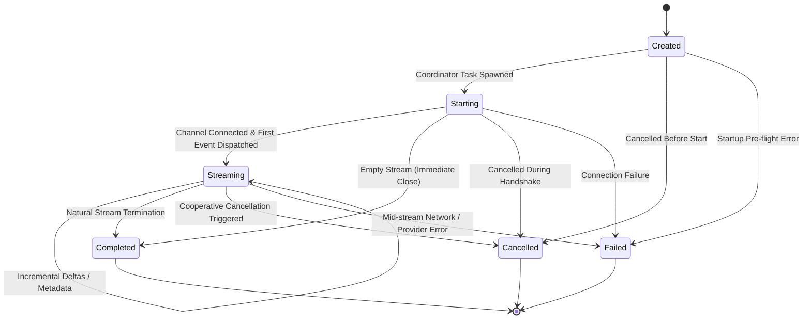

# Nano Route — Streaming Transport & Ordered IPC Infrastructure
**Document ID:** `NANO_ROUTE_STREAMING_ARCHITECTURE`  
**Version:** `1.0.0` (Milestone 15 / Step 15 of 50)  
**Status:** `APPROVED & VALIDATED`  
**Classification:** Core System Architecture Specification  

---

## 1. Purpose

The objective of Step 15 is to establish a high-throughput, provider-agnostic, ordered, and cancellable streaming transport that connects the Rust application core to the React frontend.

In modern desktop AI orchestration, models stream response tokens, reasoning thoughts, and execution status incrementally. Tauri v2 provides a dedicated `Channel<T>` abstraction specifically optimized for ordered Rust-to-frontend streaming. Step 15 establishes the production transport pipeline around **Tauri Channels + TaskManager + Provider-Neutral Stream Events**, strictly separating transport mechanics from any future provider-specific network logic or UI components.

---

## 2. Stream Lifecycle & State Machine

Streaming in Nano Route is treated as an authoritative **lifecycle**, not merely an unstructured sequence of string chunks.



### Invariant Rules:
1. **Terminal State Immutability:** `Completed`, `Cancelled`, and `Failed` are terminal. No further state transitions, deltas, or metadata events are permitted once a terminal state is entered.
2. **Double-Finalization Guard:** The `StreamCoordinator` uses atomic synchronization (`AtomicBool`) to guarantee that exactly **one** terminal event is dispatched to the channel.
3. **Automatic Reclamation:** When a stream enters a terminal state, its entry in `StreamRegistry` is pruned immediately to prevent memory leaks.

---

## 3. Stream Identifiers (`StreamId`)

Every streaming operation receives a strongly-typed `StreamId`:
- **Format:** `strm_<timestamp_ms>_<counter>` (or `strm_<epoch_36>_<rand>_<counter>`)
- **Validation:** 3 to 64 characters; matches `^[a-zA-Z0-9_-]+$`.
- **Privacy Guarantee:** Never contains user prompts, model parameters, API keys, or credentials.
- **Scope:** Used for request-task correlation, frontend state binding, cancellation routing, and audit logging.

---

## 4. Canonical Stream Event Contract

All streaming messages across the Tauri IPC Channel serialize as camelCase tagged unions:

```rust
#[derive(Serialize, Deserialize)]
#[serde(tag = "type", rename_all = "camelCase")]
pub enum StreamEvent {
    Started {
        stream_id: StreamId,
        sequence: u64,
        task_id: Option<String>,
        provider_id: Option<ProviderId>,
        model_id: Option<String>,
        timestamp_ms: u64,
    },
    Delta {
        stream_id: StreamId,
        sequence: u64,
        text: String,
    },
    Metadata {
        stream_id: StreamId,
        sequence: u64,
        metadata: StreamMetadata,
    },
    Completed {
        stream_id: StreamId,
        sequence: u64,
        finish_reason: ProviderFinishReason,
        usage: Option<ProviderUsage>,
        model_id: Option<String>,
    },
    Cancelled {
        stream_id: StreamId,
        sequence: u64,
        reason: Option<String>,
    },
    Error {
        stream_id: StreamId,
        sequence: u64,
        code: String,
        message: String,
        is_retryable: bool,
    },
}
```

---

## 5. Monotonic Sequence Ordering

Every event carries an explicit, monotonically increasing `sequence: u64`:
- `Started` is assigned `sequence: 0`.
- Each subsequent `Delta` or `Metadata` event increments the sequence counter by 1 (`1, 2, 3, ...`).
- The terminal event (`Completed`, `Cancelled`, or `Error`) carries `sequence: N + 1`.
- This explicit sequence numbering enables the frontend to audit against out-of-order, dropped, or duplicated chunks independently of low-level transport behavior.

---

## 6. Cooperative Cancellation Architecture

Stream cancellation is integrated with Step 13's native `TaskManager` and `CancellationToken`:

```text
Frontend UI / Controller
           │
           ▼
    cancelStream(streamId)
           │
           ▼
     cmd_cancel_stream
           │
           ▼
  StreamRegistry / Token
           │  token.cancel()
           ▼
   tokio::select! in Task
           │
           ▼
StreamEvent::Cancelled (seq N+1)
           │
           ▼
Registry & Task Cleanup
```

- **Race Condition Resilience:** If cancellation arrives while a delta is in flight, the cancellation branch in `tokio::select!` terminates execution immediately without hanging.
- **Idempotency:** Calling `cancelStream` multiple times or cancelling an already finished stream is a deterministic, safe no-op that returns `false` without panicking or creating duplicate events.

---

## 7. TaskManager Integration & Concurrency Boundaries

Streaming operations run as managed tasks under `TaskManager::spawn(TaskKind::Io, "stream_coordinator", None, ...)`:
- Stream tasks do not block the worker threadpool.
- Concurrency for I/O tasks is decoupled from CPU-bound tasks.
- If the application initiates shutdown, `TaskManager::shutdown()` signals the root cancellation token, gracefully aborting all active streams.

---

## 8. Tauri Channel Architecture & Rule 27

Tauri v2's native `Channel<T>` (`tauri::ipc::Channel<StreamEvent>`) is used instead of standard global events (`emit`/`listen`):

```text
                 ┌──────────────────────┐
                 │    Future Provider   │
                 │       Adapter        │
                 └──────────┬───────────┘
                            │
                            ▼
                 ┌──────────────────────┐
                 │ Normalized Provider  │
                 │    Stream Events     │
                 └──────────┬───────────┘
                            │
                            ▼
                 ┌──────────────────────┐
                 │  StreamCoordinator   │
                 │ + Lifecycle + Seq.   │
                 └──────────┬───────────┘
                            │
                     ┌──────┴──────┐
                     │             │
                     ▼             ▼
             TaskManager     Cancellation
                     │             │
                     └──────┬──────┘
                            │
                            ▼
                 ┌──────────────────────┐
                 │    Tauri Channel     │
                 │ tauri::ipc::Channel  │
                 └──────────┬───────────┘
                            │
                            ▼
                 ┌──────────────────────┐
                 │ Frontend IPC Stream  │
                 │      Service         │
                 └──────────┬───────────┘
                            │
                            ▼
                 ┌──────────────────────┐
                 │ Future Chat Studio   │
                 └──────────────────────┘
```

### Mandatory Rule 27 (Handler Attachment Timing):
In Tauri's channel architecture, messages delivered before a handler is bound are lost. Therefore, the implementation strictly enforces:
```text
1. Create new Channel<StreamEvent>()
2. Attach onmessage receiver
3. Invoke Rust command with { request, channel }
```
Attaching the handler after invocation is strictly prohibited.

---

## 9. Frontend Streaming IPC Service (`src/services/ipc/streaming.ts`)

The React frontend accesses streaming exclusively through `startStream(request)`:
- Returns an isolated `StreamController` instance.
- **Type Guarding:** Validates all incoming payloads with `isValidStreamEvent()`.
- **Unknown Event Resilience:** If future extension events (e.g. `tool_started`, `citation`) arrive, a diagnostic is recorded and older code continues safely without crashing or misinterpreting the chunk as text.
- **Convenience Subscriptions:** `.onEvent(cb)`, `.onDelta(cb)`, `.awaitCompletion()`, `.cancel()`, and `.dispose()`.

---

## 10. Channel Lifetime & Disposal

- The Rust-side channel remains active until the final event is sent and the background task terminates.
- Calling `controller.dispose()` clears all active frontend event listeners and triggers cooperative cancellation on the native core if the stream is still running.
- This prevents orphaned native tasks and eliminates React memory leaks on component unmount.

---

## 11. Backpressure Strategy & Performance

- **Zero Heavy Allocations:** Deltas are forwarded incrementally as received from upstream provider buffers.
- **No Per-Delta DB Writes:** Streamed chunks are never persisted to SQLite on a per-token basis. Content is buffered only in memory until final stream completion.
- **No Per-Delta Production Logging:** Only lifecycle milestones (`Started`, `Completed`, `Cancelled`, `Error`) are logged at diagnostic levels. Raw tokens are excluded.

---

## 12. Multi-Stream Isolation

The system supports multiple concurrent streams without cross-talk:
- Each stream possesses an independent `StreamId`, `CancellationToken`, sequence counter, and `Channel`.
- Cancelling Stream B does not affect Stream A or Stream C.
- Sequence counters remain completely isolated.

---

## 13. Error Handling & Normalization

If upstream provider streaming encounters a transport drop, socket reset, or API error:
1. The error is captured in the stream task.
2. The error is converted into normalized `StreamEvent::Error`.
3. Secret tokens are scrubbed via `sanitize_error_text`.
4. Exactly one terminal `Error` event is delivered to the frontend channel.
5. The stream is pruned from `StreamRegistry`.

---

## 14. Security & Privacy Rules

- Stream metadata and errors NEVER contain API keys, Authorization headers, bearer tokens, or password strings.
- Tauri permissions remain least-privilege under `core:default`.
- Commands cannot execute shell commands or arbitrary filesystem accesses.

---

## 15. Provider Boundary

The provider abstraction from Step 14 yields `ProviderStreamChunk` objects:
```rust
pub struct ProviderStreamChunk {
    pub text_delta: Option<String>,
    pub reasoning_delta: Option<String>,
    pub finish_reason: Option<ProviderFinishReason>,
    pub usage: Option<ProviderUsage>,
    pub is_final: bool,
}
```
Provider adapters are completely unaware of Tauri, Channels, React, or JavaScript.

---

## 16. Future Provider Integration Roadmap

When cloud provider adapters (OpenAI, Anthropic, Gemini, Groq) are added in Step 16+:
1. Provider adapter connects via HTTP SSE.
2. Adapter transforms vendor chunks into `ProviderStreamChunk`.
3. `StreamCoordinator` manages task, sequence numbering, and Tauri Channel dispatch.
4. The React Chat Studio receives identical normalized events regardless of which provider is running.

---

## 17. Verification & Test Strategy

The streaming infrastructure is verified across:
- **Rust Asynchronous Unit Tests:** `src-tauri/src/services/streaming/coordinator.rs` tests for success lifecycle, 100-delta ordering, cancellation, and registry reclamation.
- **Frontend IPC Tests:** `src/services/ipc/__tests__/streaming.test.ts` (9 test suites, 14 test assertions).
- **Total Test Suite:** 78 passed, 0 failed across 40 suites.
- **Production Bundle:** Clean `npm run validate` (typecheck + test + build in 6.17s).

---

## 18. Known Limitations

- Real cloud provider streaming is deferred to Step 16 (cloud provider integrations).
- UI presentation-layer delta throttling (e.g. `requestAnimationFrame` batching) is deferred to Step 18+ (Chat Studio UI).
- Database persistence of completed chat messages is deferred to Step 17 (storage/history).

---

## 19. Future Extension Points

- Dedicated `ToolExecution` stream events (`tool_started`, `tool_delta`, `tool_completed`).
- Dedicated `Reasoning` stream events (`reasoning_started`, `reasoning_delta`).
- Multimodal streaming events for image generation and native voice playback.

