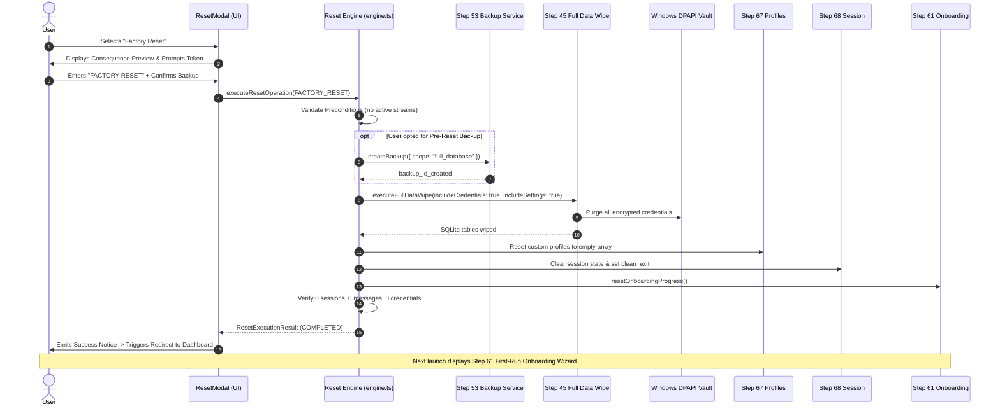

# Nano Route — Factory Reset Policy & Baseline Restoration

**Document Reference:** `docs/reset/NANO_ROUTE_FACTORY_RESET_POLICY.md`  
**Application:** Nano Route Desktop (Windows 10/11 x64, Tauri v2)  
**Implementation Phase:** Step 69  
**Authoritative Operational Policy**  

---

## 1. Definition of Factory Reset

In Nano Route, **Factory Reset** is strictly defined as:

> **Returning the local application environment to a pristine, post-installation baseline while leaving application binaries and independent backup archives intact.**

Factory Reset is **not** an operating system uninstaller. It does not delete the installed executable or wipe the user's computer. It wipes all local configuration, stored conversation messages, operational telemetry, DPAPI secrets, custom profiles, and session states created since installation.

---

## 2. Factory Reset Execution Sequence

When triggered, Factory Reset executes the following strict chronological sequence:

---

## 3. Scope of Factory Reset

### Deleted & Cleared
- **All Chat Conversations:** All session records, prompt submissions, and assistant responses.
- **All Full-Text Search Indexes:** FTS5 message and conversation search index tables.
- **All Telemetry & Analytics:** Request duration, cost tracking, token counts, and routing logs.
- **All Provider Credentials:** Encrypted DPAPI secret blobs for OpenAI, Anthropic, Gemini, Groq, DeepSeek, and Mistral.
- **All Custom Profiles:** User-created profiles; active profile ID returns to `prof_default`.
- **All Presentation Preferences:** Themes, density, text scaling, notification duration, and palette configs return to factory defaults.
- **All Session Snapshots:** `workspace.session_state` is erased; `workspace.last_exit_status` is marked `clean_exit`.
- **Onboarding Marker:** `nr_onboarding_progress_v1` is reset to state `NOT_STARTED`.

### Preserved
- **Application Binaries:** `Nano Route.exe` and native DLLs remain intact.
- **Database Backup Archives:** Saved `.db` backup snapshots in the local AppData backup folder remain untouched.
- **Windows User Environment:** No external system files, registry keys, or Windows DPAPI keys belonging to other applications are affected.

---

## 4. Post-Reset First-Run Lifecycle

Following a Factory Reset:
1. The user is redirected to the application root (`/`).
2. Step 61 first-run detection evaluates `isFirstRun(false)`: with 0 chat messages, 0 credentials, and onboarding state `NOT_STARTED`, the mandatory Onboarding Wizard activates immediately.
3. The user proceeds through model readiness, DPAPI credential entry, and routing preference setup as if launching Nano Route for the very first time.

