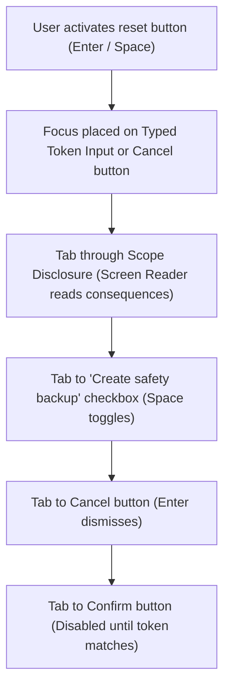

# Nano Route — Reset Framework Accessibility Specification

**Document Reference:** `docs/reset/NANO_ROUTE_RESET_ACCESSIBILITY.md`  
**Application:** Nano Route Desktop (Windows 10/11 x64, Tauri v2)  
**Implementation Phase:** Step 69  
**Authoritative Accessibility Guide**  

---

## 1. Accessibility Invariants for Destructive Operations

In accordance with WCAG 2.1 AA and Windows Desktop Accessibility guidelines:

1. **Destructive Actions Cannot Be Triggered Accidentally by Keyboard:** Tab order systematically navigates through the consequence disclosure before reaching the final confirm button.
2. **Non-Color Dependent Warnings:** Danger levels are communicated via explicit text headers, badge labels (`IRREVERSIBLE OR PRACTICALLY IRREVERSIBLE`), and distinct icons (`ShieldAlert`, `Key`, `Layers`), not solely by red or orange styling.
3. **Modal Dialog Semantics:** The confirmation modal employs `role="dialog"`, `aria-modal="true"`, and `aria-labelledby="reset-modal-title"`. Focus is trapped inside the dialog while open.
4. **Keyboard Dismissal:** Pressing `Escape` cancels and dismisses the dialog safely at any time prior to execution.
5. **Screen Reader Live Announcements:** When a reset completes or encounters an error, status changes are announced politely through Step 64 accessible notifications (`role="status"` or `role="alert"`).

---

## 2. Keyboard Navigation Flow in Reset Modal

- When typed tokens are required, the confirmation input is auto-focused upon modal mount.
- The confirm action button remains disabled (`cursor: not-allowed`, `aria-disabled="true"`) until the input matches the exact token string.

---

## 3. High-Contrast & Text Scaling Support

- High contrast borders (`1px solid`) surround all cards and warning zones.
- All typography scales cleanly with user-configured `appearance.text_scaling` (`0.85` to `1.25`) without truncation or button clipping.
- Minimum interactive target sizes (44x44px touch / 32x32px desktop click target) are respected across all buttons and inputs.

