# Nano Route — Application Reset & Factory Defaults Architecture

**Document Reference:** `docs/reset/NANO_ROUTE_RESET_ARCHITECTURE.md`  
**Application:** Nano Route Desktop (Windows 10/11 x64, Tauri v2)  
**Implementation Phase:** Step 69  
**Authoritative Architectural Specification**  

---

## 1. Architectural Mission & Core Distinction

Step 69 implements a controlled, local-first **Application Reset and Factory Defaults framework** in Nano Route. The objective is to provide deterministic, transparent, and safe mechanisms for users to restore configuration or data to defined baseline states without accidental loss of unrelated assets.

### Fundamental Principle
> **Reset is not the same as cleanup, and cleanup is not the same as disaster recovery.**

- **Step 45 (Data Lifecycle & Privacy):** Provides retention policies, dry-run previews, integrity audits, and targeted SQLite record purges.
- **Step 53 (Disaster Recovery & Backup):** Provides SHA-256 verified SQLite archive creation and point-in-time database restoration.
- **Step 66 (User Preferences):** Manages live presentation tokens, theme/density options, and preference resetting.
- **Step 67 (Workspace Profiles):** Manages custom workspace profiles and fallback to built-in presets.
- **Step 68 (Session Continuity):** Preserves and restores safe UI route navigation and window layout across restarts.
- **Step 69 (Controlled Reset Orchestration):** Establishes an explicit safety orchestration layer governing intentional baseline resets. Step 69 does not duplicate low-level deletion mechanisms; it coordinates existing authoritative services.

---

## 2. Reset Taxonomy Architecture

The reset framework establishes a strict 8-tier operation taxonomy. Each operation has an isolated, non-overlapping boundary:

```mermaid
flowchart TD
    subgraph UI_Layer["Settings > Reset & Recovery Panel / ResetModal"]
        OP1["RESET_PREFERENCES"]
        OP2["RESET_WORKSPACE"]
        OP3["RESET_SESSION_STATE"]
        OP4["REMOVE_PROVIDER_CREDENTIAL"]
        OP5["RESET_APPLICATION_CONFIGURATION"]
        OP6["CLEAR_SELECTED_USER_DATA"]
        OP7["FULL_LOCAL_DATA_RESET"]
        OP8["FACTORY_RESET"]
    end

    subgraph Precondition_Gate["Precondition Gatekeeper (engine.ts)"]
        CHK_STREAM["Check Active Streams (chat.ts / updater.ts)"]
        CHK_LOCK["Check DB Write Locks"]
        CHK_UPGRADE["Check Active Updates / Restore"]
    end

    subgraph Service_Delegates["Authoritative Subsystem Delegates"]
        S66["Step 66 Preference Service (resetAllUserPreferences)"]
        S67["Step 67 Profiles Service (profiles / activeProfileId)"]
        S68["Step 68 Session Service (session_state / clean_exit)"]
        DPAPI["Windows DPAPI Vault (deleteProviderCredential)"]
        S45["Step 45 Privacy Service (executeDataCleanup / executeFullDataWipe)"]
        S53["Step 53 Backup Service (createBackup pre-reset)"]
        S61["Step 61 Onboarding Storage (resetOnboardingProgress)"]
    end

    OP1 --> Precondition_Gate
    OP2 --> Precondition_Gate
    OP3 --> Precondition_Gate
    OP4 --> Precondition_Gate
    OP5 --> Precondition_Gate
    OP6 --> Precondition_Gate
    OP7 --> Precondition_Gate
    OP8 --> Precondition_Gate

    Precondition_Gate --> CHK_STREAM
    Precondition_Gate --> CHK_LOCK
    Precondition_Gate --> CHK_UPGRADE

    Precondition_Gate -->|"RESET_PREFERENCES"| S66
    Precondition_Gate -->|"RESET_WORKSPACE"| S67
    Precondition_Gate -->|"RESET_SESSION_STATE"| S68
    Precondition_Gate -->|"REMOVE_PROVIDER_CREDENTIAL"| DPAPI
    Precondition_Gate -->|"RESET_APPLICATION_CONFIGURATION"| S45
    Precondition_Gate -->|"CLEAR_SELECTED_USER_DATA"| S45
    Precondition_Gate -->|"FULL_LOCAL_DATA_RESET"| S45
    Precondition_Gate -->|"FACTORY_RESET"| S45
    Precondition_Gate -.->|"Pre-Reset Backup (Optional)"| S53
    Precondition_Gate -->|"FACTORY_RESET Post-Action"| S61
```



---

## 3. Subsystem Roles & Responsibilities

1. **`src/features/reset/types.ts`:**
   - Defines strict enum types: `ResetOperationType`, `ResetClassification`, `ResetOperationStatus`.
   - Declares required confirmation tokens: `FACTORY RESET`, `DELETE`, `RESET CONFIG`.
   - Defines contracts for preview metadata, preconditions, execution requests, and result verification.

2. **`src/features/reset/catalog.ts`:**
   - Authoritative registry defining exact "Will change", "Will be deleted", "Will remain", and "Recovery options" for every operation.

3. **`src/features/reset/engine.ts`:**
   - Enforces runtime preconditions (blocking operations if active streaming or database operations are underway).
   - Coordinates optional pre-reset backup generation via Step 53 (`createBackup`).
   - Dispatches reset execution strictly to authoritative domain services.
   - Executes post-reset verification to confirm target data removal and default state activation.

4. **`src/features/reset/components/ResetModal.tsx`:**
   - Accessible WCAG 2.1 AA dialog providing multi-step preview, consequence disclosure, backup checkbox, and typed token input.
   - Eliminates single-click accidental destruction.

5. **`src/features/reset/components/ResetWorkspacePanel.tsx`:**
   - Visual presentation organized into 5 distinct impact groups in Settings > Reset & Recovery.
   - Connects to Step 64 notifications and Step 66 preference contexts.

---

## 4. Operation Lifecycle & Execution States

Every reset operation moves through a deterministic state machine:

```text
NOT_STARTED
    │
    ▼ (User triggers action in UI)
VALIDATING (Check confirmation flag, verify typed token, evaluate preconditions)
    │
    ▼ (Preconditions satisfied)
PREPARING (Optional: Generate pre-reset SQLite safety backup via Step 53)
    │
    ▼ (Preparation completed)
EXECUTING (Execute targeted reset via authoritative domain delegates)
    │
    ▼ (Execution finished)
VERIFYING (Run automated post-reset assertion checks on database/settings/DPAPI)
    │
    ▼
COMPLETED (Emit Step 64 notification; trigger onboarding/restart if Factory Reset)
    ▲
    │ (On error or precondition block)
FAILED / BLOCKED / CANCELLED
```

