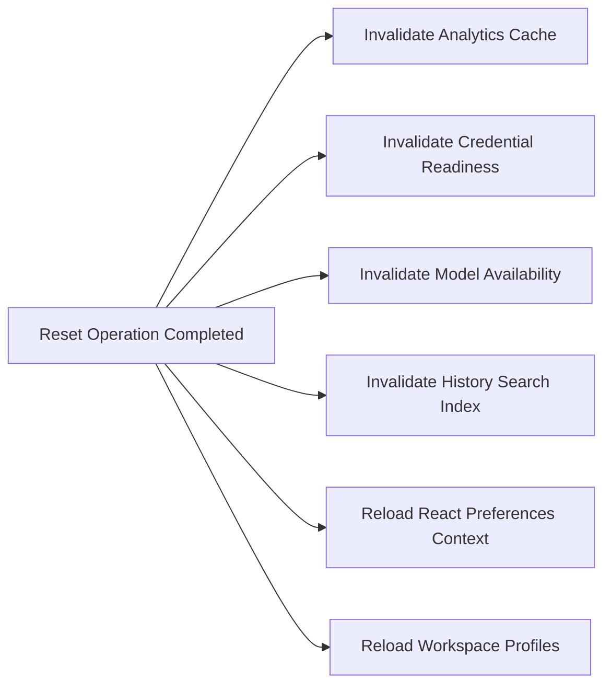

# Nano Route — Reset Data Lifecycle & State Invalidation

**Document Reference:** `docs/reset/NANO_ROUTE_RESET_DATA_LIFECYCLE.md`  
**Application:** Nano Route Desktop (Windows 10/11 x64, Tauri v2)  
**Implementation Phase:** Step 69  
**Authoritative Operational Guide**  

---

## 1. Interaction with Step 45 Data Lifecycle

Step 69 integrates directly with Step 45 data classification and retention mechanics:

- **Tier 1 (Transient Operational Data):** In-memory buffers, active stream sockets, and temporary query states are cleared immediately prior to reset execution.
- **Tier 2 (User Conversation History & Search):** Tables `chat_sessions`, `chat_messages`, and `fts_messages` are cleared atomically within an SQLite transaction.
- **Tier 3 (Operational Telemetry & Metrics):** Table `telemetry_records` is purged, and in-memory analytics accumulators are cleared.
- **Tier 4 (Configuration & User Preferences):** Table `app_settings` keys are restored to documented default constants.

---

## 2. Derived State Invalidation & Cache Eviction

Following any reset operation, derived application caches are invalidated to prevent stale or ghost data:

1. **Analytics Invalidation:** Cached cost, token, and latency metrics are invalidated immediately. Subsequent analytics views query the database directly and display updated totals (or legitimate zeros).
2. **Provider Readiness Invalidation:** In-memory provider status maps are refreshed via `listProviderCredentialStatuses()`. Providers with removed keys immediately transition to `isConfigured: false`.
3. **Search Index Invalidation:** FTS5 full-text search indexes are cleared or rebuilt. Deleted conversations will never return search hits.
4. **Session Invalidation:** Saved session snapshots are erased. Session continuity starts safely at `/` on next boot.

---

## 3. SQLite Storage Semantics Disclosure

Consistent with Step 45 and Step 60 privacy disclosures:
> Removed records are logically deleted from the local SQLite application database. SQLite free-page reuse and WAL checkpointing do not constitute cryptographic disk-sector erasure. Users requiring physical block overwrites should utilize BitLocker drive encryption.

