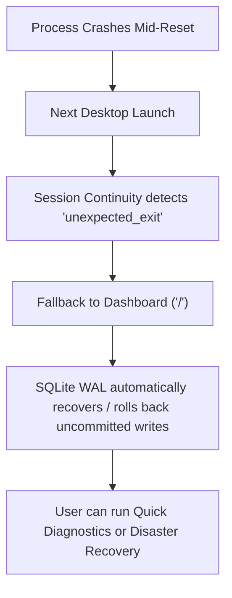

# Nano Route — Reset Failure Recovery & Crash Safety

**Document Reference:** `docs/reset/NANO_ROUTE_RESET_FAILURE_RECOVERY.md`  
**Application:** Nano Route Desktop (Windows 10/11 x64, Tauri v2)  
**Implementation Phase:** Step 69  
**Authoritative Operational Guide**  

---

## 1. Concurrency Locks & Precondition Failures

Destructive reset operations are barred from executing during conflicting application tasks:

| Active Condition | System Behavior | Remediation Guidance |
| :--- | :--- | :--- |
| **Prompt Streaming Active** | Precondition check halts reset; returns status `BLOCKED`. | "Active AI generation or streaming request in progress. Cancel or await completion first." |
| **Database Transaction Writing** | Precondition check halts reset; returns status `BLOCKED`. | "Active database transaction in progress. Please wait a moment and try again." |
| **Application Update Active** | Precondition check halts reset; returns status `BLOCKED`. | "Application update installation in progress. Reset operations are blocked." |
| **Disaster Recovery Restore Active** | Precondition check halts reset; returns status `BLOCKED`. | "Disaster recovery restore operation currently active. Reset is blocked." |
| **Backup Archive Creating** | Precondition check halts reset; returns status `BLOCKED`. | "Backup archive creation currently in progress. Reset is blocked." |

---

## 2. Multi-Stage Failure & Partial Completion Handling

If a multi-stage reset fails partway through execution:

1. **Stop Safely:** Execution aborts immediately without attempting subsequent stages.
2. **Report Accurate State:** The engine marks the operation as `FAILED` and enumerates the specific `stagesCompleted` (e.g. `["VALIDATING", "PREPARING_BACKUP"]`).
3. **Never Falsely Report Success:** The application never claims a Factory Reset completed if credential deletion or table truncation encountered an exception.
4. **Preserve Safety Backup:** Any pre-reset backup successfully generated during `PREPARING_BACKUP` remains intact on disk and is reported in the failure result.
5. **Diagnostics Guidance:** The user is provided a categorized error description and a direct link to open the Diagnostics Center (Step 62) to inspect database health.

---

## 3. Crash During Reset Recovery

If the operating system shuts down or the application terminates abruptly during a reset:

- **SQLite WAL Atomicity:** SQLite WAL journaling ensures that any half-written transaction is rolled back on next connection open. The database file is never left in an unparseable state.
- **Crash Marker Safety:** Step 68 session continuity detects the missing clean exit, displays a safe recovery notice, and falls back to `/`.

