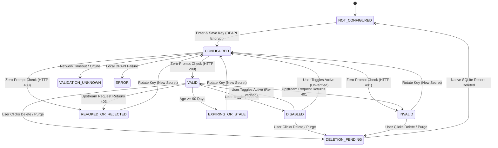

# Nano Route — Credential State Model

**Document Version:** 1.0.0  
**Status:** Authoritative  
**Step:** 74 — Credential State Machine & Lifecycle Transitions  
**Subsystems:** Credential Lifecycle Engine, Provider Management UI, Preflight Evaluator  

---

## 1. Overview

Nano Route implements an explicit 10-state lifecycle model for provider credentials. This state machine eliminates ambiguous states (such as assuming a configured key is healthy) and provides deterministic feedback for the user interface, automatic routing preflight checks, and emergency containment workflows.

---

## 2. Authoritative State Vocabulary

The domain type `CredentialValidationStatus` consists of:

```typescript
export type CredentialValidationStatus =
  | "NOT_CONFIGURED"
  | "CONFIGURED"
  | "VALIDATION_UNKNOWN"
  | "VALID"
  | "INVALID"
  | "REVOKED_OR_REJECTED"
  | "EXPIRING_OR_STALE"
  | "DISABLED"
  | "DELETION_PENDING"
  | "ERROR";
```

### State Definitions & Semantics

| State | Description | Routing Eligible? | UI Indicator |
| :--- | :--- | :--- | :--- |
| `NOT_CONFIGURED` | No credential ciphertext exists in the DPAPI vault. | No | Grey badge: "Unconfigured" |
| `CONFIGURED` | Ciphertext exists in DPAPI vault, but has not yet been validated against upstream metadata. | Preflight check required | Blue badge: "Configured (Unverified)" |
| `VALIDATION_UNKNOWN` | Validation probe was attempted but ended in an indeterminate state (e.g., DNS timeout, network offline). | Degraded / Fallback candidate | Yellow badge: "Reachability Unknown" |
| `VALID` | Outbound zero-prompt metadata check succeeded with HTTP 200 OK. | **Yes** | Green badge: "Active & Verified" |
| `INVALID` | Upstream provider rejected the key with HTTP 401 Unauthorized or bad format error. | No | Red badge: "Invalid API Key" |
| `REVOKED_OR_REJECTED`| Upstream provider reported key revoked, account suspended, or access forbidden (HTTP 403). | No | Red badge: "Revoked / Forbidden" |
| `EXPIRING_OR_STALE` | Credential has not been rotated for $>90$ days. Key may still function but requires hygiene review. | Yes (with warning notice) | Amber badge: "Stale (> 90 Days)" |
| `DISABLED` | User explicitly toggled the provider inactive locally. Ciphertext is preserved in DPAPI vault. | No | Grey/Orange badge: "Locally Disabled" |
| `DELETION_PENDING` | User initiated local deletion; purge is actively processing in native core. | No | Red spinner: "Deleting..." |
| `ERROR` | Local technical failure occurred (e.g., DPAPI decryption failure, SQLite lock). | No | Red badge: "System Error" |

---

## 3. State Transition Diagram



---

## 4. Preflight Routing Integration

When the Intelligent Router selects candidate models for a user query, it inspects the provider credential lifecycle state:
1. **Fully Eligible:** `VALID`
2. **Conditionally Eligible (with validation trigger):** `CONFIGURED`, `EXPIRING_OR_STALE`
3. **Ineligible (Excluded from Routing Candidates):** `NOT_CONFIGURED`, `INVALID`, `REVOKED_OR_REJECTED`, `DISABLED`, `DELETION_PENDING`, `ERROR`.

If all cloud candidates are ineligible, the application automatically routes prompts to the on-device SLM runtime, guaranteeing complete operational resilience.

