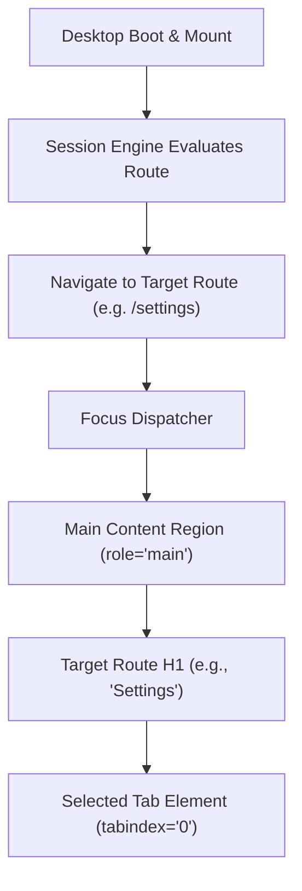

# Nano Route — Workspace Session Continuity Accessibility Specification

**Document Reference:** `docs/session/NANO_ROUTE_SESSION_ACCESSIBILITY.md`  
**Application:** Nano Route Desktop (Windows 10/11 x64, Tauri v2)  
**Implementation Phase:** Step 68  
**Authoritative Accessibility Guide**  

---

## 1. Accessibility Invariants for Session Restoration

Session continuity must operate smoothly for assistive technology users without introducing jarring focus shifts, disorienting route jumps, or silent UI layout modifications.

### Core Principles

1. **Predictable Focus Placement:** When restoring a previous session to a specific route, keyboard focus must be systematically directed to the primary landmark (main heading or primary interactive container) rather than being lost in the DOM or trapped in a closed modal.
2. **Screen Reader Notification of Restored State:** When the user launches the application, screen readers (Narrator, NVDA, JAWS) must receive a clear aria-live announcement if the workspace was restored from a previous session or reset due to an unexpected exit.
3. **Respect for Reduced Motion (`prefers-reduced-motion`):** Any visual transitions associated with restoring layout (sidebar width adjustments, panel tab switching) must be instantaneous when reduced motion is requested.
4. **No Keyboard Traps:** If the application previously closed with a dialog, dropdown, or command palette open, that overlay must **never** be restored in an open state on startup. Overlays must start closed, ensuring the tab order remains clear.

---

## 2. ARIA Live Region & Screen Reader Announcements

The session restoration lifecycle emits concise, polite screen reader announcements:

- **Clean Session Restored:** `"Workspace session restored to [View Name]."`
- **Crash Recovery Fallback:** `"Previous session ended unexpectedly. Reset workspace to Dashboard for safety."`
- **Session Opt-Out / Default Route:** `"Welcome to Nano Route Dashboard."`

These announcements are routed through the existing accessible live region announcer established in Step 60 and Step 64.

---

## 3. Focus Management on Startup

- If restoring to `/chat`, focus lands in the main chat landmark or input container.
- If restoring to `/settings`, focus lands on the active tab header in the tablist.
- If restoring to `/help`, focus lands on the Help search input or primary category list.

---

## 4. High Contrast & Layout Persistence

- Sidebar collapsed/expanded states restored across sessions maintain standard WCAG 2.1 AA touch and click targets (minimum 44x44px).
- Toggle controls in General Settings for `workspace.restore_previous_session` include explicit `aria-checked` states, accessible labels, and high-contrast focus rings.

