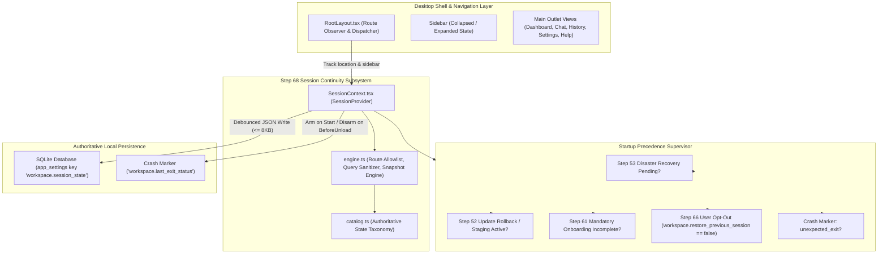
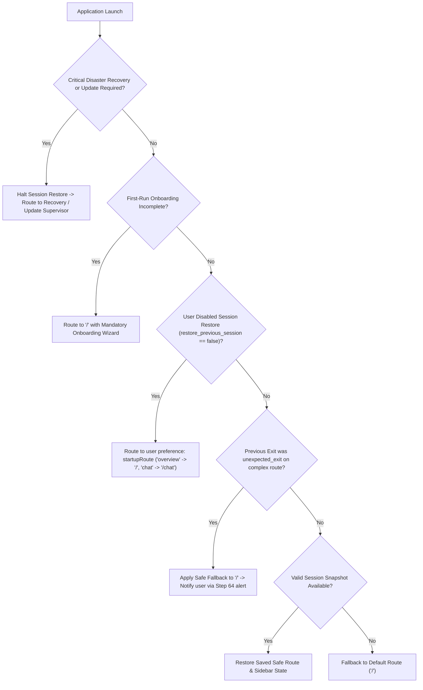

# Nano Route — Workspace Session Continuity & Safe UI State Restoration Architecture

**Document Reference:** `docs/session/NANO_ROUTE_SESSION_CONTINUITY_ARCHITECTURE.md`  
**Application:** Nano Route Desktop (Windows 10/11 x64, Tauri v2)  
**Implementation Phase:** Step 68  
**Authoritative Architectural Specification**  

---

## 1. Executive Summary & Design Invariants

Step 68 introduces a controlled, local-first **Workspace Session Continuity and Safe UI State Restoration system** into Nano Route. The objective is to make the desktop experience continuous across normal restarts, application closures, Windows reboots, updates, and unexpected process crashes without compromising the strict security, privacy, and functional guarantees of the application.

### Core Architectural Axioms

1. **Non-Sensitive Presentation Scope:** Session continuity strictly restores safe navigation context and visual layout arrangements (last safe route, active profile ID, sidebar state, selected settings tab).
2. **Zero Runtime Replay / Zero Resumed Streams:** Transient runtime state (active SSE streams, Tokio task handles, native sockets, DirectML inference runs, and uncommitted database transactions) is **never** restored. Interrupted requests remain terminated; streams are never falsely represented as running.
3. **Strict Precedence Hierarchy:** Critical startup failures, disaster recovery requirements, update migrations, and mandatory onboarding strictly override session restoration.
4. **Crash-Safe Fallback:** If an unexpected exit occurs while on a complex configuration view, Nano Route automatically applies safe fallback to the Dashboard (`/`) to prevent crash loops.
5. **Decoupled Architecture:** Session continuity operates independently from Step 66 Preferences and Step 67 Workspace Profiles. Session state captures *where the user was*, while profiles define *how the workspace looks and behaves*.

---

## 2. Architecture & Data Flow

---

## 3. Subsystem Roles & Responsibilities

- **`SessionProvider` (`src/features/session/SessionContext.tsx`):**
  - Manages session lifecycle on mount.
  - Reads previous `workspace.last_exit_status` and `workspace.session_state`.
  - Evaluates startup precedence.
  - Arms the crash marker (`unexpected_exit`) on boot and disarms it to `clean_exit` on `beforeunload`.
  - Coordinates debounced saves (500ms debounce) to avoid excessive disk I/O.
- **`engine.ts` (`src/features/session/engine.ts`):**
  - Enforces `ROUTE_ALLOWLIST` and query parameter sanitization.
  - Serializes snapshots to `nano-route-workspace-session-v1` format.
  - Enforces strict 8KB size ceiling (`MAX_SESSION_PAYLOAD_BYTES = 8192`).
  - Evaluates startup precedence via `resolveStartupRoute()`.
- **`RootLayout.tsx` (`src/layouts/RootLayout.tsx`):**
  - Consumes `restoreResult` from `useSessionContinuity()`.
  - Seamlessly redirects to the restored safe route on initial mount.
  - Observes route and sidebar changes and forwards updates to `saveSessionState()`.
- **`GeneralSettingsPanel.tsx` (`src/features/settings/components/GeneralSettingsPanel.tsx`):**
  - Exposes user opt-in/opt-out toggle `workspace.restore_previous_session`.
  - Surfaces a non-intrusive status badge indicating clean exit or recovery from unexpected termination.

---

## 4. Startup Precedence Hierarchy

