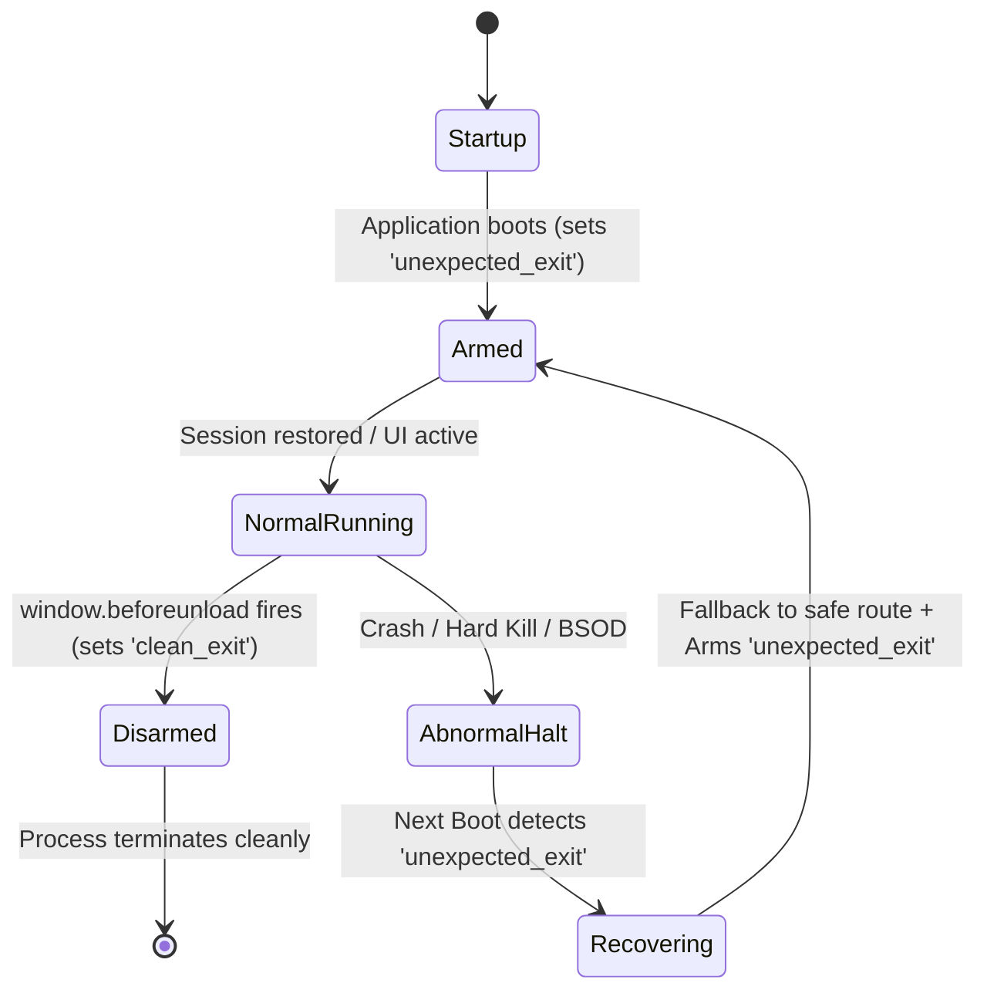

# Nano Route — Session Continuity Failure Recovery & Crash Marker Lifecycle

**Document Reference:** `docs/session/NANO_ROUTE_SESSION_FAILURE_RECOVERY.md`  
**Application:** Nano Route Desktop (Windows 10/11 x64, Tauri v2)  
**Implementation Phase:** Step 68  
**Authoritative Operational Guide**  

---

## 1. Crash Marker Lifecycle & Exit States

To distinguish between orderly desktop shutdown and abnormal termination (crash, power loss, task manager termination), Nano Route maintains a crash marker in `app_settings` under the key `workspace.last_exit_status`.

### State Machine

### Marker Value Catalog

- **`clean_exit`:** The application previously exited normally via the window close button, keyboard shortcut, or tray quit command. `beforeunload` successfully updated `workspace.last_exit_status` to `clean_exit`.
- **`unexpected_exit`:** The previous session terminated without firing `beforeunload`. Likely causes: unhandled Rust panic, native DirectML crash, out-of-memory kill, or Windows system power cut.
- **`startup_recovery`:** An unexpected termination occurred during initialization before the shell became interactive.
- **`unknown`:** Default or uninitialized state (treated as clean exit).

---

## 2. Crash-Safe Navigation Fallback

When `workspace.last_exit_status === "unexpected_exit"` is detected at startup:

1. **Complex View Shielding:** If the recorded route in the session snapshot was a resource-intensive or configuration view (e.g. `/settings`, `/models`, `/providers`), the session engine automatically overrides the route and redirects to the safe default (`/` - Dashboard).
2. **Crash Loop Prevention:** This prevents the application from repeatedly re-entering a view that may have triggered the previous crash (e.g. attempting to re-render a corrupt model profile or unparseable provider config).
3. **Notification Notification:** A non-intrusive alert (or Settings status badge) indicates that the previous session experienced an abnormal termination and was safely reset to the Dashboard.

---

## 3. Storage Failure & Disk Exhaustion

1. **Atomic Settings Writes:** Session state is written to SQLite via existing transaction-backed settings IPC. SQLite WAL journaling guarantees that partial disk writes do not corrupt the database.
2. **Debounced Persistence:** To prevent write amplification during window resizing or rapid navigation, session saves are throttled with a 500ms debounce window.
3. **Write Failure Isolation:** If a disk I/O error or SQLite write failure occurs, the error is logged to native diagnostics without throwing an unhandled exception or interrupting current user interaction.

